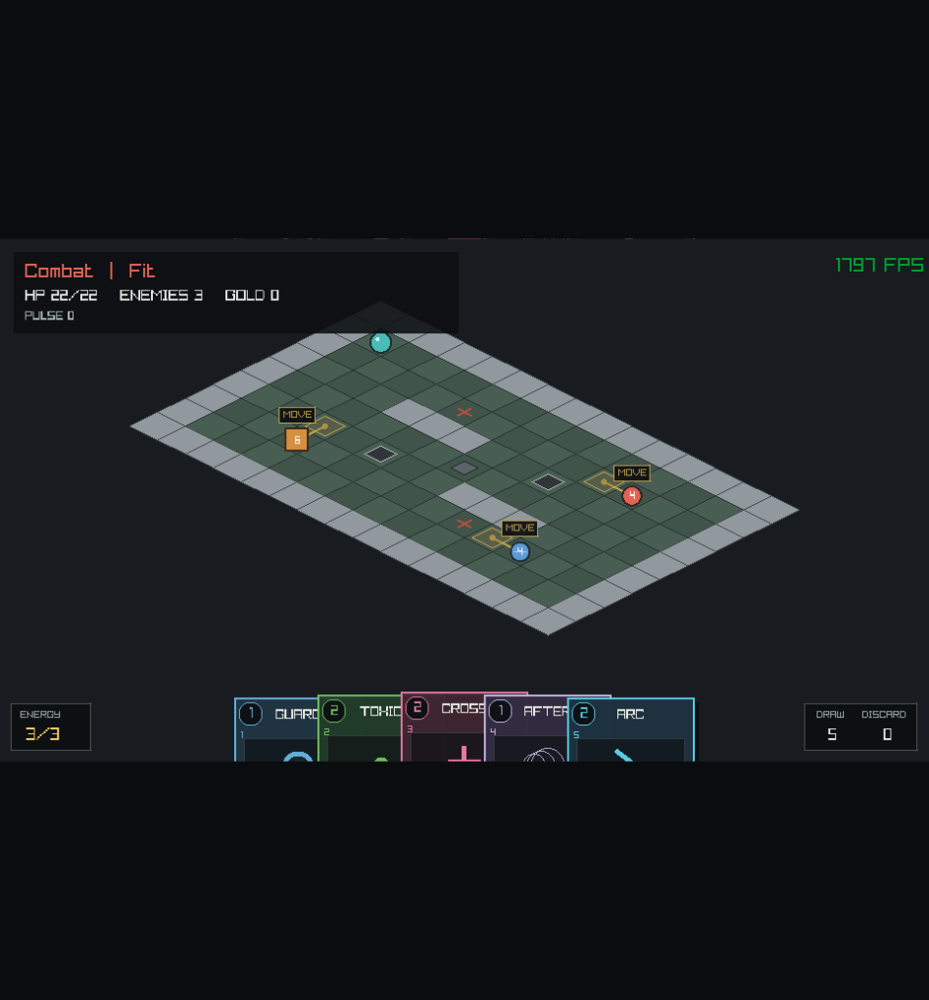
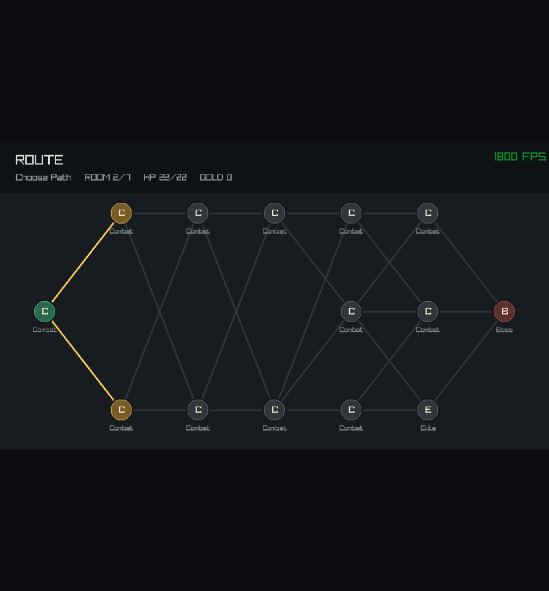
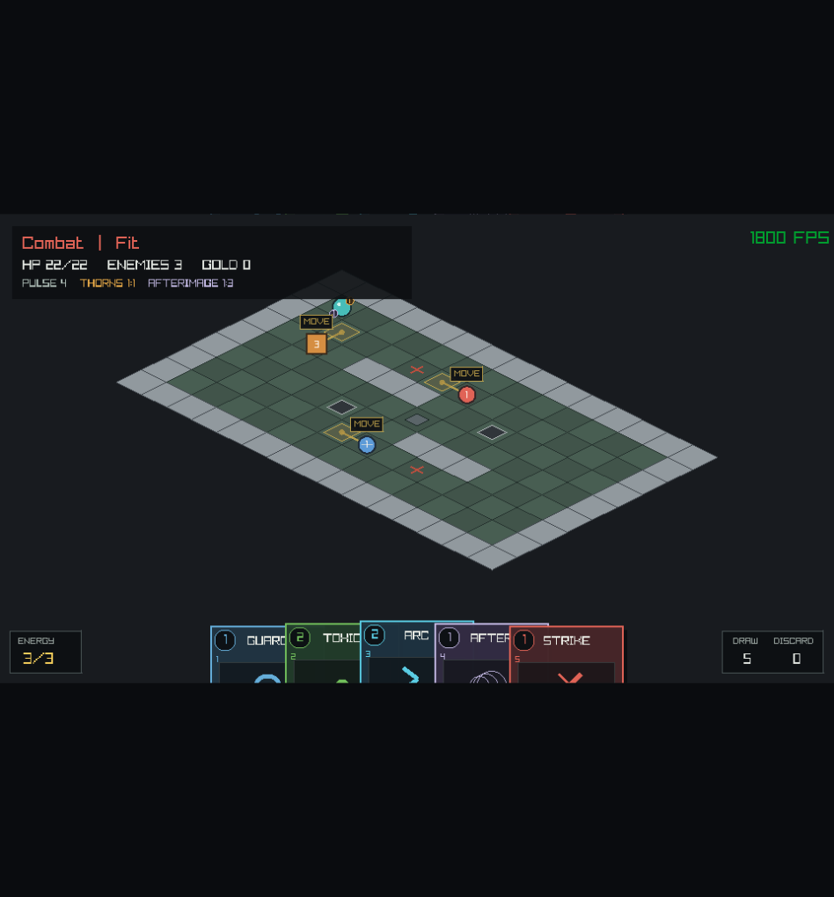
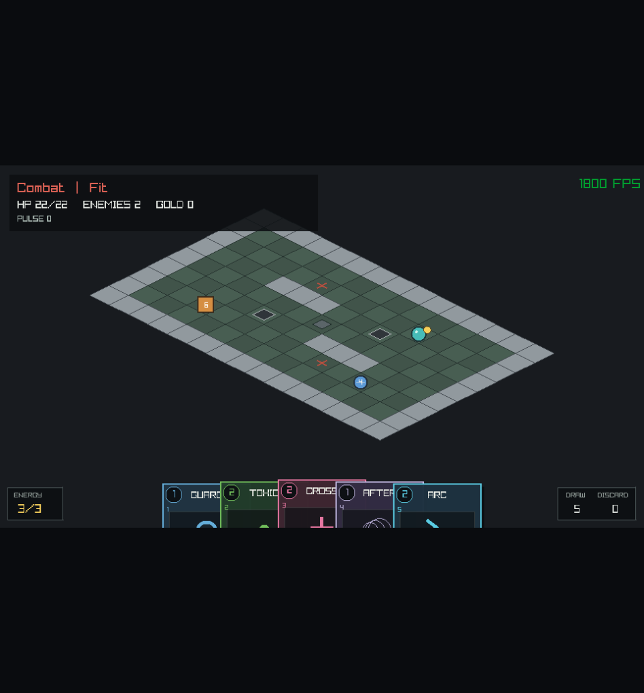
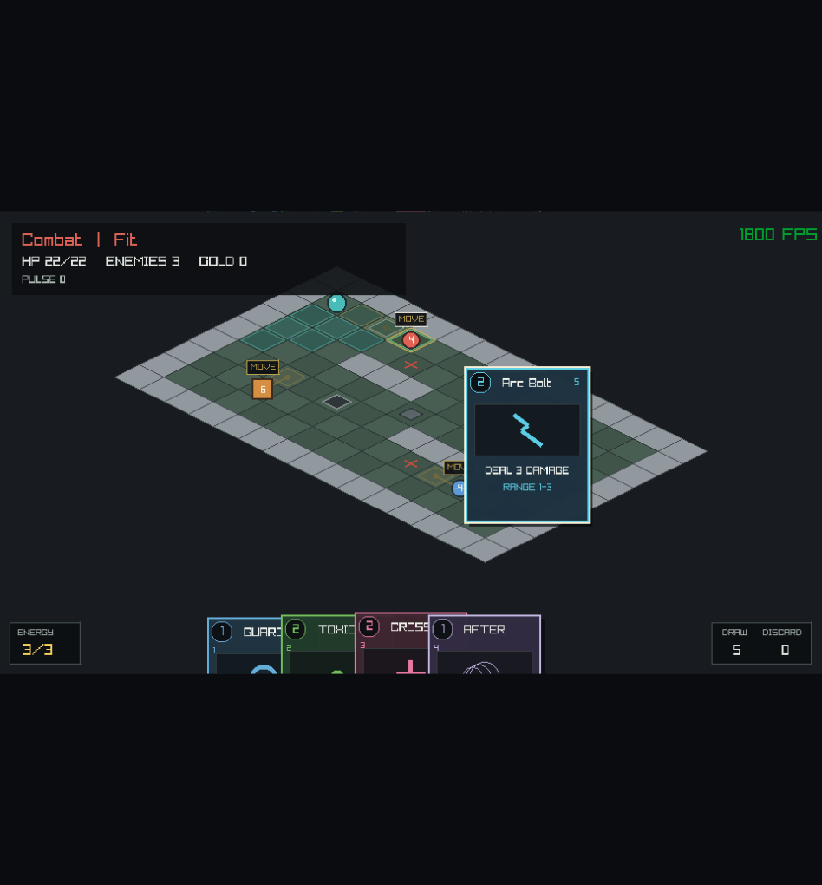
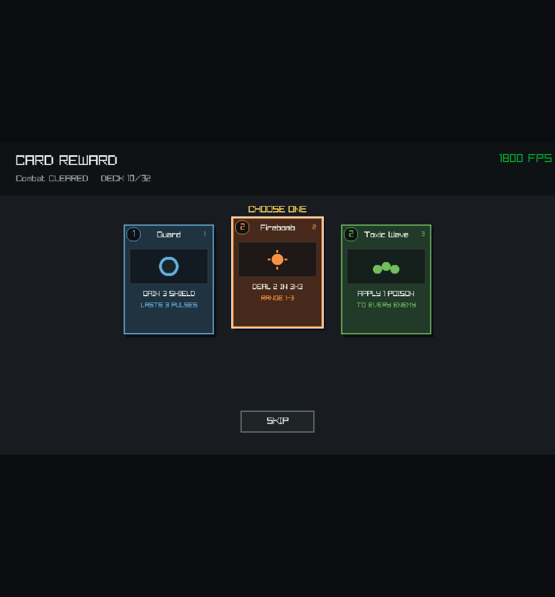
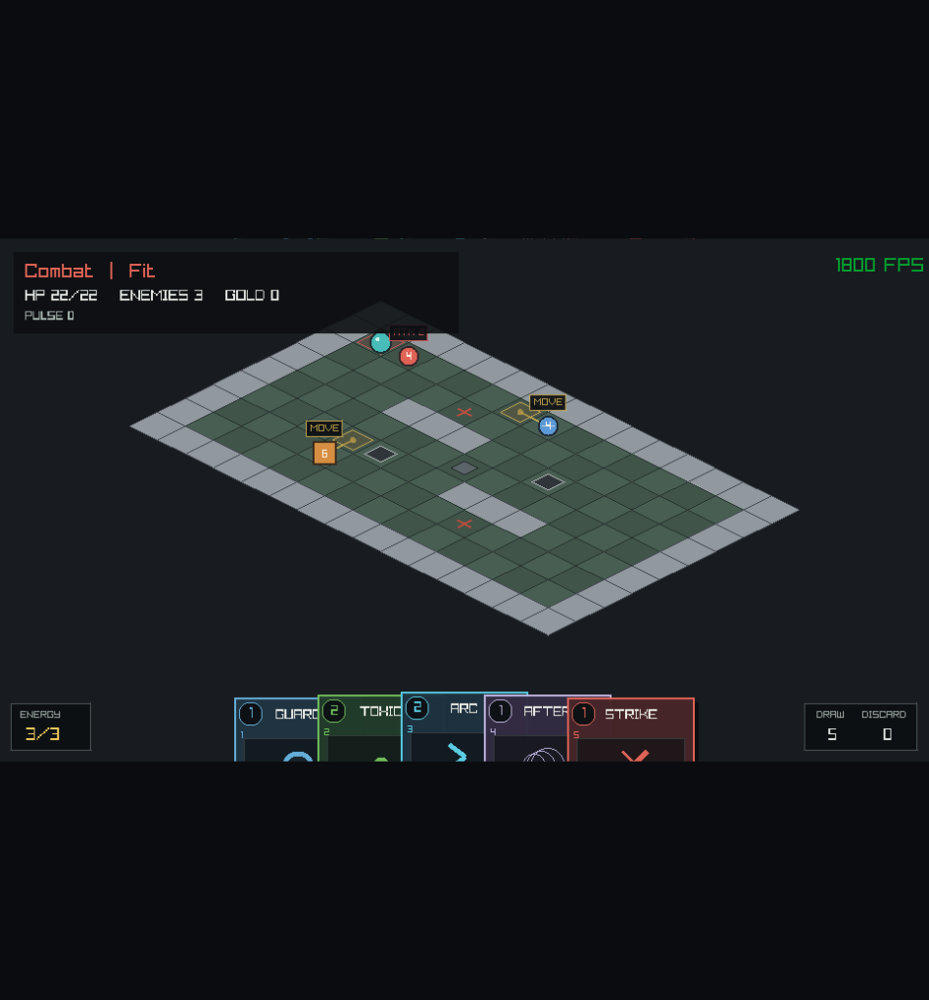
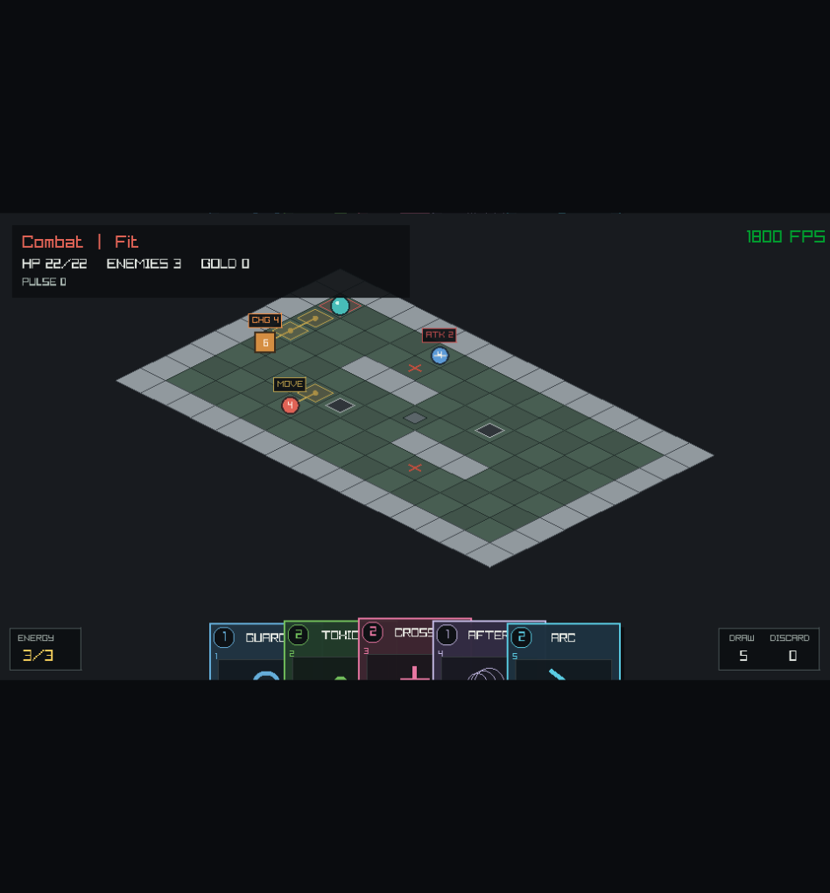
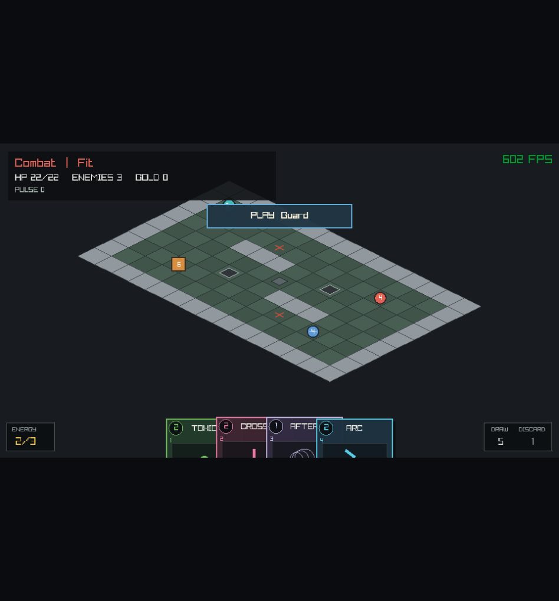
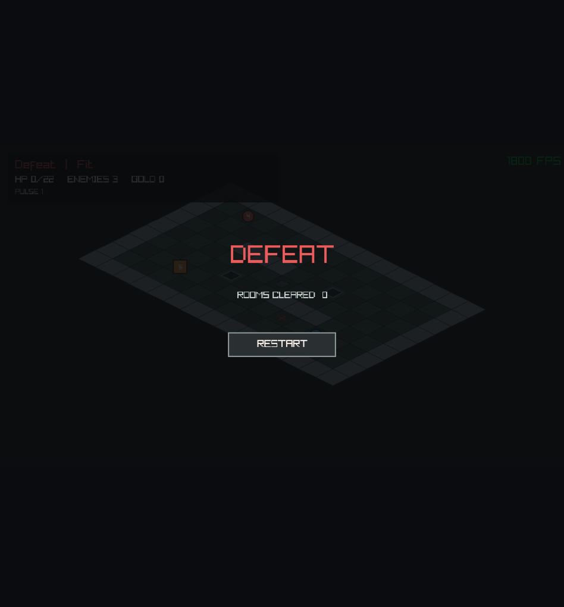

# Odin 2D Engine

Vertical slice di un roguelike 2D a griglia isometrica scritto in Odin.

Documentazione del gameplay: [Action System](ACTION_SYSTEM.md),
[Status And Event System](STATUS_SYSTEM.md), [Reaction Queue](REACTION_SYSTEM.md),
[Enemy Intents](ENEMY_INTENT_SYSTEM.md),
[Magnetic Loot](LOOT_SYSTEM.md), [Card System](CARD_SYSTEM.md),
[Targeting System](TARGETING_SYSTEM.md), [Deck Runtime](DECK_SYSTEM.md) e
[Card Rewards](REWARD_SYSTEM.md). Il confine fra simulazione, animazioni e input
bufferizzato e documentato in [Presentation Timeline](PRESENTATION_TIMELINE.md).






















## Eseguire la demo

```sh
odin run src
```

La creazione delle stanze aggiorna `Room` tramite puntatore, evitando grandi copie
per valore che LLVM trasformerebbe in migliaia di operazioni. `-o:none` resta
disponibile per esperimenti senza ottimizzazione; `odin build src -out:odin_pp`
produce invece un eseguibile persistente.

La demo apre una finestra ridimensionabile e avvia una run di sette stanze con
nemici, trappole, ostacoli, loot, uscite e una rotta procedurale.

Per produrre lo screenshot deterministico del targeting avanzato:

```sh
odin run src -- --smoke-targeting
```

Il flag prepara `Firebomb`, mostra cast range e footprint sulla griglia, salva
`odin_pp_advanced_targeting.png` dopo tre frame e chiude la demo.

Per verificare la timeline con uno snapshot pre-comando e un cue carta attivo:

```sh
odin run src -- --smoke-timeline
```

## Loop attuale

1. La stanza parte in `Combat`: il deck viene mescolato, si pescano cinque carte
   e il player riceve tre energia.
2. Prima dell'input, inseguitori, arcieri e bruti mostrano l'intento committed per
   il prossimo impulso: movimento, attacco, carica e celle minacciate non vengono
   ricalcolati dopo la scelta del player.
3. Le carte pagano il proprio costo, pescano un rimpiazzo e recuperano una energia
   per impulso; movimento e attesa possono essere usati per recuperarla.
4. Ogni passo valido, bump attack, attesa, abilita o carta accettata produce un
   impulso se il fight continua. Il player puo camminare senza un limite numerico,
   ma ogni cella attraversata concede la risposta committed ai nemici.
5. Ogni drop entro tre celle per asse viene assorbito anche durante `Combat`;
   eliminato l'ultimo nemico, la stanza passa a `Loot` e gli spostamenti non
   producono piu pulse.
6. Entrare sull'uscita verde conclude la stanza e apre `Reward` con tre carte distinte.
7. Scegliere una carta la aggiunge al deck; `Skip` prosegue senza modificarlo.
8. `Choose_Path` permette di scegliere uno dei due o tre nodi collegati.
9. L'ultimo nodo e il boss. Superarlo porta a `Victory`; morire apre `Defeat`, da
   cui si puo iniziare una nuova run con `Enter` o il pulsante `Restart`.

Gli attacchi a contatto restano disponibili accanto alle carte. Carte e bump
attack costruiscono normali `Action`: il bump non sposta il player, ma produce
comunque un pulse. Il suo costo tattico e quindi la risposta nemica, non il
posizionamento.

### Controlli

| Input | Azione |
|---|---|
| hover su carta | solleva la carta e mostra regole, costo e cast range |
| trascina carta sulla griglia | mostra anchor, percorso, footprint e blocker; prova la giocata sulla cella di rilascio |
| `1`-`8` | gioca una carta non spaziale o seleziona una carta spaziale |
| click su cella | usa la carta spaziale selezionata da tastiera sull'anchor |
| `Esc` / click destro | annulla selezione o trascinamento |
| `WASD` | un comando per pressione: muove il player; contro un nemico esegue un attacco |
| `Spazio` | aspetta un impulso durante il combattimento |
| `C` `V` | abilita debug per Thorn Coat e Afterimage |
| frecce | sposta la camera |
| rotella | zoom ancorato al cursore |
| trascinamento rotella | sposta la camera col mouse |
| `R` | inquadra nuovamente il livello |
| `M` | mostra o nasconde la rotta durante una stanza |
| click / `1` `2` `3` | sceglie una carta durante `Reward` |
| `S` / pulsante Skip | salta la ricompensa |
| click / `1` `2` `3` | sceglie uno dei nodi disponibili |
| `Enter` / pulsante Restart | avvia una nuova run dalla schermata `Defeat` |
| `F5` | crea una nuova run con un seed diverso |
| `F1` | scaling fit con letterbox |
| `F2` | integer scaling |
| `F3` | scaling stretch |
| `F11` | fullscreen borderless |

## Eseguire i test

```sh
odin test src/grid
odin test src/level
odin test src/view
odin test src/game
odin test src/render
```

## Simboli della mappa

| Simbolo | Tile |
|---|---|
| spazio | vuoto |
| `.` | pavimento |
| `#` | muro |
| `+` | porta |
| `@` | spawn del player |
| `>` | uscita |

## Struttura attuale

```text
src/
  main.odin         # demo e punto di ingresso
  app/              # finestra, canvas virtuale e presentazione
  game/             # simulazione della stanza e stato persistente della run
  grid/             # container generico Grid(T)
  level/            # semantica delle tile e costruzione dei livelli
  render/           # renderer isometrico Raylib
  view/             # scaling, proiezione e camera testabili
```

`grid` non conosce il gioco. Gestisce solo coordinate, memoria contigua e
accesso sicuro. `level` assegna un significato alle celle e dipende da `grid`.
`Run_State` possiede il player e il grafo della rotta. Una `Room` possiede soltanto
le entita temporanee e prende in prestito un puntatore al player della run. Il
renderer legge questi dati, ma non li possiede e non li cambia.

Input, IA, trappole e loot costruiscono `Action` composte da effetti ordinati.
`resolve_action` valida sorgente, target ed effetti prima di modificare la stanza;
lo scheduler degli impulsi resta separato dal resolver.
Ogni nemico conserva inline un intento committed per `pulse_count + 1`.
Pianificazione e risoluzione seguono gli ID in ordine crescente; spostarsi fuori
da una cella minacciata produce un miss, mentre occupare una destinazione puo
bloccare un movimento senza causare replanning.
`Enemy_Archetype` seleziona tre planner sulla stessa pipeline: il `Chaser` avanza
o attacca in melee, l'`Archer` arretra quando viene ingaggiato e spara lungo una
linea ortogonale libera, mentre il `Brute` puo attraversare piu celle con una
carica telegrafata che infligge danno doppio. Corpo, badge e colori distinguono
gli archetipi senza spostare decisioni di gameplay nel renderer.
`Shield`, `Poison`, `Thorns` e `Afterimage` hanno potenza e durata in impulsi.
L'HUD li mostra come `potenza:impulsi`; gli eventi dell'ultimo comando sono
conservati dalla stanza.
`Thorns` converte gli eventi di danno avversario in azioni reattive. Una queue
FIFO risolve le catene senza ricorsione e conserva l'ordine causale degli eventi.
Le definizioni dichiarano trigger, filtri, priorita e template degli effetti;
`Afterimage` usa la stessa pipeline osservando gli eventi di movimento.
I binding runtime aggiungono owner, potenza, cariche, durata e sorgente carta o
passiva senza duplicare le definizioni.
`Card_Definition` e `Card_Instance` compilano targeting, upgrade ed effect
template in normali `Action`. `Targeting_Spec` separa cast range e footprint:
Single, linee nelle otto direzioni, croci e quadrati 3x3 condividono clipping,
line of sight e blocker statici. La query raccoglie ID nemici stabili; il
renderer visualizza il risultato senza ricalcolare la geometria. `Deck_State`
conserva ownership, draw pile, mano, discard ed energia in array fissi; shuffle e
reshuffle sono deterministici.
`play_card` paga e sposta la carta soltanto dopo che l'azione e stata accettata.
Fra stanza e mappa, `Run_Phase.Reward` offre tre definizioni distinte tramite un
RNG dedicato. Soltanto la scelta confermata crea una nuova `Card_Instance`; skip,
indice invalido e deck pieno non consumano ID e non modificano ownership.
La mano compatta a ventaglio, hover e drag sono stato di presentazione: durante
il trascinamento il renderer interroga `evaluate_card_targeting` per ogni anchor
e per la cella puntata. La compilazione riesegue la stessa query autorevole prima
della giocata.
Durante `Combat` e `Loot`, i drop entro distanza Chebyshev tre vengono raccolti
tramite normali `Action`, anche quando si trovano sopra trappole, ostacoli o
uscita. Oro e cura vengono assegnati subito dalla simulazione autorevole; gli
eventi prodotti dal comando alimentano poi la presentazione.
Prima di eseguire un comando accettato viene catturato uno snapshot della stanza;
dopo la risoluzione ne viene catturato un secondo per i valori terminali. La
`Room` risolve sincronicamente l'intera azione, mentre il renderer riproduce gli
eventi in una timeline FIFO sulla copia presentazionale. Movimento, danno,
status, mano, energia, sconfitte e loot restano nello stesso ordine causale senza
rallentare o modificare la simulazione.
Durante la timeline, il primo nuovo comando discreto viene conservato in un
buffer di capacita uno; gli input successivi vengono scartati. Quando la timeline
torna idle, il comando viene estratto e validato di nuovo contro la `Room`
autorevole. Drag, click e preview del targeting spaziale sono sospesi mentre lo
snapshot e indietro, per evitare di confrontare il mouse con due stati diversi.
Le transizioni verso `Reward`, `Victory` e `Defeat` vengono mostrate soltanto
dopo l'ultimo cue. Restart, cambio stanza e cambio schermata svuotano timeline e
buffer. Il contratto completo e in
[Presentation Timeline](PRESENTATION_TIMELINE.md).
I comandi turn-based restano edge-triggered: tenere premuto un tasto non genera
repeat e non riempie il buffer. A vita zero, un overlay `Defeat` separa
chiaramente lo stato terminale da un blocco dell'input e offre un restart esplicito.
La scena viene prima disegnata su un canvas virtuale `960x540`, poi adattata
alla finestra reale secondo la modalita di scaling selezionata.

La griglia e interamente bidimensionale: ogni cella vive sullo stesso piano e
possiede soltanto coordinate `(x, y)`. La sensazione di profondita deriva dalla
proiezione isometrica e dall'ordine di disegno, non da quote o livelli verticali.

## Generazione della rotta

La rotta e un grafo diretto aciclico organizzato in livelli:

- un solo nodo iniziale e un solo boss finale;
- due o tre nodi per ogni livello intermedio;
- archi soltanto verso il livello immediatamente successivo;
- massimo tre uscite per nodo e nessun arco duplicato;
- ogni nodo generato e raggiungibile dall'inizio e conduce verso il boss.

Il generatore Xoshiro usa uno stato locale inizializzato da seed. Non modifica il
generatore casuale globale: stesso seed e stessa configurazione producono sempre
la stessa rotta. `validate_run_map` ricontrolla tutte le invarianti prima che una
run venga accettata.
