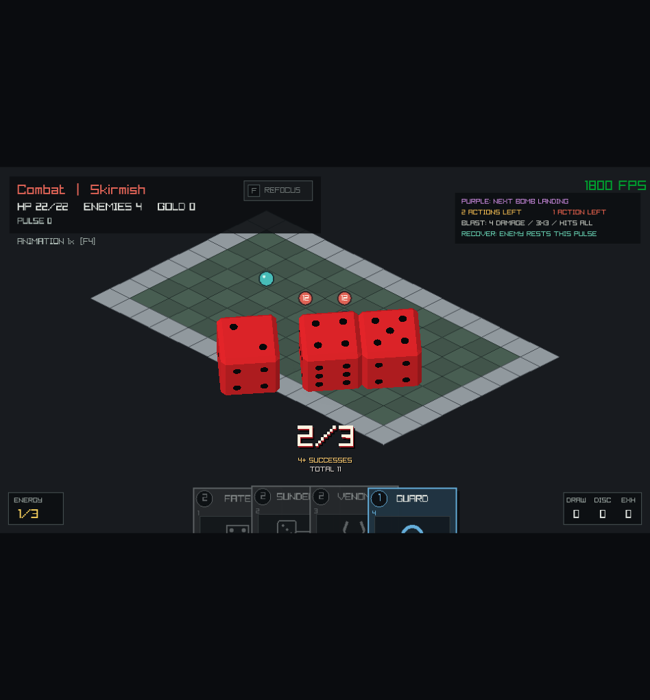
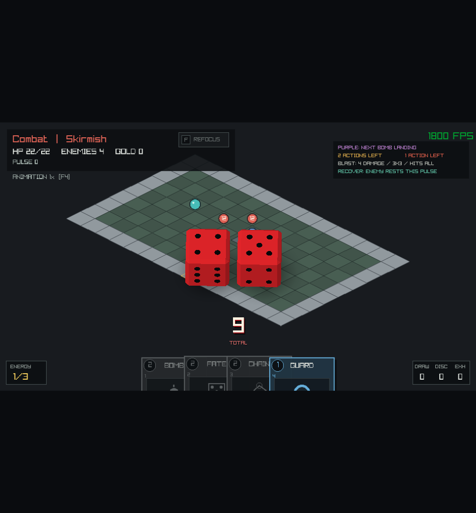

# Incantesimi, dado e animazioni

Firebomb, Fate Strike, Chain Lightning, Sundering Blow, Prismatic Barrage e Twin Venom usano le stesse regole di targeting,
danno, reazioni e impulsi delle altre carte. Le animazioni rendono visibili il
lancio e gli impatti; il risultato viene deciso dalla simulazione e non dipende
dalla velocita delle animazioni o dai file grafici caricati.

Fate Strike, Chain Lightning, Sundering Blow, Prismatic Barrage e Twin Venom fanno parte delle normali offerte di ricompensa e
dello shop. Per provarle subito e disponibile un'arena dedicata.

## Arena di prova

```sh
odin run src -- --spell-lab
```

L'arena presenta quattro nemici e una mano iniziale ordinata di cinque carte:

1. Firebomb;
2. Fate Strike;
3. Chain Lightning;
4. Sundering Blow;
5. Guard.

Usa i normali controlli delle carte: trascina una carta sul bersaglio oppure
selezionala con il relativo numero e clicca sulla griglia. Firebomb si presta a
colpire il gruppo dei tre nemici vicini; Fate Strike e Chain Lightning partono
da un nemico selezionato. Prima di confermare, la preview mostra i bersagli
previsti e gli eventuali rimbalzi.
Sundering Blow raggiunge il primo nemico direttamente dalla posizione iniziale;
la destinazione della spinta e marcata `8+` per indicare la condizione sul tiro.

`F5` ricrea la sessione di prova con la mano pronta. Restano attive le normali
regole di energia, azioni accettate e risposta dei nemici: l'arena consente di
provare le carte senza aspettare di trovarle nella run. `--spell-lab` va usato
senza opzioni di smoke o report di playtest.

Per provare tutte le carte con dadi, usa `odin run src -- --dice-lab`:
la mano contiene Fate Strike (`1`), Sundering Blow (`2`), Prismatic Barrage (`3`),
Twin Venom (`4`) e Guard (`5`). I controlli e il reset con `F5` sono gli stessi.
La preparazione dell'arena conserva lo stream dei dadi; `F5` inizia invece una
nuova sessione con un nuovo seed, come nella normale partita.

## Carte e portata

Nella tabella, `U` indica il livello di upgrade della singola carta. I valori di
danno sono precedenti a difesa, Shield e altre risposte del normale resolver.

| Carta | Costo | Primo bersaglio | Effetto |
| --- | --- | --- | --- |
| Firebomb | 2 energia | Cella calpestabile a distanza Chebyshev da 1 a 3, con linea di vista | `2 + U` danni ai nemici e agli oggetti validi nell'area 3x3 |
| Fate Strike | 2 energia | Nemico a distanza Manhattan da 1 a 4, con linea di vista | `2 + U + D6` danni; con un 6, un possibile rimbalzo da `3 + U` danni |
| Chain Lightning | 2 energia | Nemico a distanza Manhattan da 1 a 4, con linea di vista | `3 + U` danni per bersaglio, fino a tre nemici distinti |
| Sundering Blow | 2 energia | Nemico allineato a distanza Manhattan da 1 a 2, con linea di vista | `2D6 + U` danni; somma dei dadi almeno 8: spinta di una cella |
| Prismatic Barrage | 2 energia | Nemico a distanza Manhattan da 1 a 3, con linea di vista | `3D6`: ogni `4+` vale `3 + U` danni; ogni dado da 1 a 3 vale 1 Shield per 2 impulsi |
| Twin Venom | 2 energia | Nemico a distanza Manhattan da 1 a 3, con linea di vista | `1 + maggiore dei 2D6 + U` danni; una coppia applica Poison 2 per 2 impulsi al bersaglio sopravvissuto |

Manhattan conta i passi ortogonali: una diagonale di una cella vale due.
Chebyshev conta quella stessa diagonale come una cella. Il targeting condiviso
controlla anche muri, oggetti che bloccano la linea di vista e geometria dell'area;
la preview usa le stesse query della risoluzione.

L'intera carta paga il costo una sola volta e avanza al massimo un impulso del
normale ciclo di combattimento, se lo scontro prosegue. Un rimbalzo non
costituisce un nuovo play della carta e non paga un secondo costo.

## Fate Strike e D6

Il tiro produce un intero da 1 a 6 con probabilita uguale per ogni faccia. Senza
upgrade, il primo colpo infligge quindi da 3 a 8 danni. Solo un 6 abilita il
secondo colpo, se esiste un altro nemico valido entro la portata del rimbalzo.
Non avere un secondo bersaglio non impedisce di giocare la carta.

La preview mostra la distribuzione `1-6 EQUALLY LIKELY` e la probabilita `1/6`
del bonus. Il collegamento verso il secondo bersaglio e tratteggiato e marcato
`6 ONLY`: indica una possibilita, non un risultato gia noto. Passare con il
mouse, selezionare la carta o compilare il targeting non tira il dado.

`Player.dice` conserva uno stream dedicato e un contatore dei tiri, separati dagli
RNG del mazzo, della rotta, degli incontri e delle ricompense. La sequenza resta
riproducibile con lo stesso seed e gli stessi tiri accettati, senza essere
alterata da una pesca o da un'animazione. Il campionamento scarta i valori che
introdurrebbero uno sbilanciamento nell'operazione modulo 6.

Il tiro viene calcolato su una copia temporanea dello stato. Lo stato del dado
e l'evento `Dice_Rolled` vengono confermati soltanto quando il primo colpo e
accettato. Una giocata rifiutata non consuma un tiro.

## Sundering Blow e lanci multipli

Sundering Blow tira due D6 indipendenti e infligge la somma, piu il livello di
upgrade. Se la somma dei soli dadi e almeno 8, aggiunge la normale spinta di una
cella: il bonus di upgrade aumenta i danni ma non modifica la soglia. La
probabilita della spinta e `15/36` (circa 42%). Un bersaglio bloccato puo comunque
subire il danno; un bersaglio morto non viene spostato.

`Dice_Roll` conserva fino a tre facce, conteggio e totale. `roll_d6_pool` lavora
su una copia e conferma lo stream soltanto se l'intero gruppo riesce. Fate usa
lo stesso formato con un solo dado. Un evento `Dice_Rolled` descrive l'intero
lancio: il numero dei dadi non moltiplica costo, impulsi o attesa della timeline.

## Successi e coppie

Prismatic Barrage valuta separatamente i tre dadi: ogni 4, 5 o 6 e un successo,
con probabilita `1/2` per dado. I danni dei successi vengono aggregati in un solo
colpo, da zero a `9 + 3U`; i dadi bassi danno invece da zero a tre Shield.
Lo Shield arriva prima del danno e puo quindi assorbire una risposta come Thorns.
Con zero successi la carta concede tre Shield senza lanciare un attacco: resta
una giocata valida e consuma normalmente costo e impulso. La probabilita di
almeno un successo e `7/8`.

Twin Venom sceglie il maggiore dei due dadi: i danni vanno da `2 + U` a `7 + U`.
Le sei coppie sui 36 esiti possibili aggiungono Poison (`1/6`). Il veleno segue
le normali regole degli status, inclusi gli impulsi e la sinergia con Venom Vial;
non viene applicato a un nemico gia ucciso dal danno diretto. L'upgrade aumenta
solo il danno, mentre potenza, durata e probabilita del veleno restano fisse.

La presentazione raccoglie successi o valore massimo man mano che i dadi vengono
letti e segnala la coppia solo dopo il secondo dado. La somma rimane visibile
in piccolo per entrambi i lanci. Queste letture derivano dalle facce registrate:
non richiedono altri tiri e la preview non anticipa l'esito.



## Mesh e presentazione fisica

I dadi sono rossi con puntini neri e spigoli smussati. Una piccola simulazione
3D cosmetica li lascia cadere verso il centro, con gravita, rotazione, urti
contro il piano e fra dadi. Il lancio viene precalcolato a passo fisso e
riprodotto dal progresso della timeline. La numerazione completa di ogni cubo
viene orientata prima della riproduzione in modo che la faccia finale mostri il
risultato committed; i numeri non cambiano durante la caduta e le facce opposte
continuano a sommare sette. La fisica non legge o modifica il RNG del gameplay.
Il solver usa cubi orientati, contatti con impulsi e attrito; le mesh visive
smussano gli spigoli del collisore. Una correzione finale minima elimina il
tremolio residuo quando una faccia e gia appoggiata. Il calcolo e limitato a tre
corpi e viene eseguito una volta per lancio, poi si campionano i frame salvati.
I primi due urti cadenti con il piano ricevono una spinta verticale esplicita:
12 e poi 9 unita al secondo. Ogni spinta viene applicata una sola volta al nuovo
contatto; un dado gia appoggiato non riceve energia aggiuntiva. Dal terzo urto
agiscono la restituzione ordinaria, l'attrito e lo smorzamento. L'altezza del
rimbalzo e limitata anche nelle finestre molto alte.
Gli stessi due urti danno anche un impulso angolare al corpo simulato: ogni
dado ha un asse di capriola diverso, derivato dal seed cosmetico. La rotazione
continua durante la risalita e gli impatti successivi, fino all'assestamento.
Questi impulsi e lo smorzamento laterale sono una scelta arcade per mantenere
il tiro energico e raccolto al centro dello schermo.
Il rilascio conserva una rotazione in caduta e varia con il seed cosmetico.
Il primo salto raggiunge circa 3,4 lati di dado e il secondo circa 2 nelle
fixture di verifica. Il playback individua i veri contatti della traiettoria:
il secondo volo occupa circa 0,25 secondi a velocita 1x, senza essere compresso
nella coda di assestamento. Dopo il terzo contatto restano circa 0,37 secondi
per i piccoli rotolamenti; una curva continua rallenta il campionamento fino
all'arresto. L'ombra resta ancorata al piano durante la risalita;
il pass trasparente conserva correttamente l'alpha e usa una composizione
premoltiplicata, cosi la distanza dal piano rimane leggibile.

La durata nominale del gruppo e 2,1 secondi a velocita 1x, con caduta leggibile
e una pausa finale. I 0,3 secondi aggiuntivi riguardano solo l'assestamento:
i primi tre contatti restano a 0,648, 0,972 e 1,224 secondi. Le facce vengono
lette soltanto dopo l'arresto. Segue F4 e la compressione delle sequenze lunghe. Durante
la riproduzione in finestra, un frame avanza al massimo di 1/18 del tiro:
un rallentamento non puo saltare l'intera risalita. I primi tre contatti vengono
mostrati almeno per un frame prima di proseguire; a velocita regolare questo
aggiunge al massimo tre frame al tiro. Il tempo eccedente viene scartato,
mentre i seek espliciti dei test restano immediati. Nei lanci
multipli un totale fluttuante raccoglie i valori, con un piccolo impulso per
ogni aggiunta. Non ci sono pannelli o cornici attorno ai dadi; il tiro singolo
di Fate continua a mostrare il risultato direttamente sui puntini.

Una RenderTexture trasparente riutilizzata contiene l'intera scena. Il passaggio
3D avviene prima del canvas della partita; la texture viene composta dopo il
canvas in coordinate finestra. I dadi attraversano anche il letterbox e
mantengono proporzioni uniformi in Stretch. Le risorse GPU vengono liberate
prima della chiusura della finestra.

## Rimbalzi e percorso committed

`query_spell_path` sceglie i bersagli prima di iniziare la risoluzione:

- ogni salto parte dalla posizione del bersaglio precedente;
- il prossimo nemico deve essere vivo, non ancora visitato, entro tre passi
  Manhattan e con linea di vista libera;
- viene scelto il nemico piu vicino; a parita di distanza vince l'ID piu basso;
- Chain Lightning conserva al massimo tre bersagli, Fate Strike al massimo due.

La preview di Chain Lightning numera i bersagli nell'ordine previsto. Quella di
Fate Strike distingue il primo colpo dal secondo, condizionato al risultato 6.

Durante la risoluzione il percorso resta quello iniziale. Ogni colpo attraversa
la normale pipeline di danno e completa le proprie reazioni prima del colpo
successivo. Se il player muore, il combattimento termina o il prossimo bersaglio
previsto non esiste piu, il resto della catena viene interrotto. Non viene scelto
un sostituto e un nemico comparso nel frattempo non viene aggiunto al percorso.

La carta resta nella zona `Resolving` per l'intera sequenza. Costi, uscita dalla
zona, pesca e avanzamento del combattimento restano responsabilita del normale
play della carta.

## Lancio, impatto e danni simultanei

Gli eventi `Spell_Launched` e `Spell_Impact` descrivono le posizioni del lancio e
degli impatti. Fate Strike aggiunge `Dice_Rolled` prima del lancio. La timeline
presenta questi eventi prima dei danni corrispondenti e conserva l'ordine delle
reazioni fra i colpi della catena.

Firebomb ha una preparazione visibile, un proiettile con traiettoria ad arco e
un'esplosione unica per l'area. I feedback dei suoi effetti diretti ricevono un
`visual_group` esplicito: danni, assorbimenti e conseguenze dirette compatibili
possono apparire insieme, invece di allungare l'esplosione per ogni bersaglio.
Le mutazioni degli snapshot restano ordinate come il log autorevole. Reazioni,
movimento e confini degli impulsi continuano a essere presentati in FIFO; non
vengono uniti al gruppo soltanto perche appartengono alla stessa carta.

`Spell_Impact.area_mask` conserva le nove possibili celle dell'area come bit,
filtrati dalla query prima dei danni. Il renderer non dipinge come bersagli muri,
ostacoli statici o celle fuori griglia e non interroga lo stato futuro della
stanza per ricostruire l'area.

Senza immagini personalizzate, Firebomb usa particelle e cerchi procedurali,
Chain Lightning un fulmine azzurro e Fate Strike effetti viola. Questo incremento
non aggiunge audio o un pacchetto di illustrazioni.

## PNG, GIF e clip evento

La guida [Immagini e animazioni personalizzate](SPRITES.md) descrive il manifest,
i limiti di caricamento e gli esempi per PNG statici, sprite sheet e GIF.

Le clip collegate agli incantesimi sono `player_cast`, `player_hit`,
`firebomb_cast`, `firebomb_projectile`, `firebomb_impact`, `chain_bolt`,
`fate_cast` e `fate_impact`. Sono riprodotte una volta durante la rispettiva fase
della timeline. Il loro progresso segue l'evento, dal primo all'ultimo frame;
`fps` continua invece a governare i loop dei corpi.

Due istanze possono condividere la stessa texture mantenendo progressi distinti.
Le GIF vengono decodificate al caricamento, non durante gli impatti. Una clip
assente o non valida conserva il corrispondente effetto procedurale e non cambia
il risultato del combattimento.

## Verifica

Gli smoke di Firebomb, dado e Chain Lightning preparano carte reali, le giocano
attraverso la simulazione e presentano il log risultante. Dopo lo screenshot
verificano anche il completamento della timeline e la corrispondenza dello stato
presentato. Lo smoke della preview mostra invece il targeting prima della
conferma, senza eseguire una giocata.

| Comando | Screenshot |
| --- | --- |
| `odin run src -- --smoke-firebomb-spell` | `odin_pp_firebomb_spell.png` |
| `odin run src -- --smoke-dice` | `odin_pp_dice.png` |
| `odin run src -- --smoke-dice-pool` | `odin_pp_dice_pool.png` |
| `odin run src -- --smoke-chain` | `odin_pp_chain.png` |
| `odin run src -- --smoke-spell-preview` | `odin_pp_spell_preview.png` |
| `odin run src -- --smoke-sunder-preview` | `odin_pp_sunder_preview.png` |
| `odin run src -- --smoke-barrage` | `odin_pp_barrage.png` |
| `odin run src -- --smoke-twin-venom` | `odin_pp_twin_venom.png` |



Lo smoke del dado prepara uno stato RNG il cui prossimo tiro valido e 6, per
esercitare anche il bonus. Non modifica la distribuzione del dado nella partita.
Lo smoke del pool usa una somma reale di 9 per verificare anche la spinta di
Sundering Blow; lo screenshot mostra il totale completo, prima dei danni.
Gli smoke di Barrage e Twin Venom usano rispettivamente due successi su tre e
una coppia di quattro, ottenuti da veri seed dello stesso generatore della run.
Per verificare caricamento e riproduzione delle clip personalizzate e disponibile
anche `odin run src -- --smoke-sprites`.

```sh
odin test src -all-packages -define:ODIN_TEST_THREADS=1 -o:none
odin check src -vet -strict-style
```

La suite copre determinismo e isolamento del dado, giocate rifiutate, percorso
dei rimbalzi, linea di vista, parita fra ID, reazioni fra colpi, fine del
combattimento, replay e gruppi di presentazione. I test geometrici del dado
verificano le sei facce finali, la rigidita durante il movimento, la leggibilita
dei puntini, il contatto con il piano, la caduta e il comportamento del letterbox
senza aprire una finestra.
I controlli del playback misurano anche lo spostamento in pixel alla dimensione
minima della finestra, a 30/60 fps e alle velocita 1x, 2x e 4x. La verifica GPU
dell'ombra e della riproduzione completa affianca i controlli della fisica.
