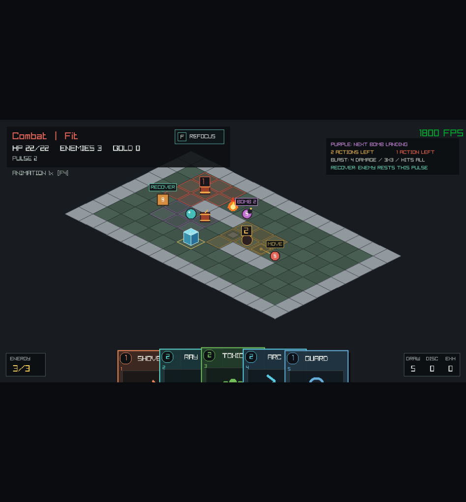

# Combattimento tattico

Avvia la partita con `odin run src`. Le stanze combinano nemici, barili, ghiaccio
e fuoco secondo composizioni riconoscibili. I nodi Combat contengono normalmente
un barile, un Ice Block e una cella Fire; Polveriera aggiunge un secondo barile.
Elite e Boss contengono sei oggetti, con piu barili nelle Polveriere. La posizione
varia con il seed e mantiene un percorso iniziale senza attraversare Fire.

## Come spostare un barile

Serve **Shove in mano e un punto energia**. Camminare contro il barile durante
il combattimento non lo spinge.

1. Mettiti accanto al barile, sopra, sotto, a destra o a sinistra: la portata di
   Shove e una cella, senza diagonali.
2. Premi il numero dello slot di Shove e clicca sul barile, oppure trascina la carta sopra il barile.
   Puoi cliccare anche il corpo rialzato dell'oggetto.
3. Controlla la freccia: la spinta va di una cella **lontano dal player** e la
   destinazione deve essere libera.

Il suggerimento mostra portata, destinazione, energia e miccia. `PUSH 1` indica
una spinta possibile; `BLOCKED` una destinazione occupata. Su un barile spento,
**Shove infligge comunque il colpo e accende la miccia anche se la spinta e
bloccata**: la carta e l'impulso vengono consumati. Su un esplosivo gia acceso,
una spinta impossibile viene invece rifiutata, perche non avrebbe alcun effetto.

## Esplosivi e decisioni

| Segnale | Significato |
|---|---|
| `BOMB 2`, area viola | il Bombarolo lancera una bomba nella zona indicata |
| `2`, area ambra | restano due azioni accettate prima dello scoppio |
| `1`, area rossa | la prossima azione accettata fa scoppiare l'esplosivo |
| `SHIELD 3`, linea turchese | il Custode proteggera l'alleato indicato |
| `RECOVER N` | quel nemico resta fermo per i prossimi N impulsi |
| `FURNACE: FIRE IN N ACTIONS` | la corsia indicata colpira dopo N azioni |

Una bomba infligge **4 danni base nel 3x3**, inclusi player, nemici e oggetti
danneggiabili. Difesa e Shield riducono normalmente il danno agli attori. Muri e
ostacoli fissi sono esclusi dall'area; i blocchi distruttibili possono subire il
colpo. Il danno non richiede una linea di vista attraverso le altre celle del
3x3: l'overlay mostra esattamente le celle coinvolte.

Il conto alla rovescia misura le decisioni, non i secondi delle animazioni.
Un comando rifiutato non consuma la miccia. Il comando che accende un barile o
fa arrivare una bomba termina il proprio impulso; restano poi **due ulteriori
azioni accettate**. Alla seconda, dopo l'azione del player e prima degli intenti
nemici, l'esplosivo scoppia.

## Combo disponibili

- **Strike / Arc Bolt → barile:** il danno accende la miccia invece di
  distruggere subito il barile.
- **Firebomb → barile:** il 3x3 della carta colpisce anche gli oggetti
  danneggiabili e puo accenderli, anche senza nemici nell'area.
- **Shove → barile:** lo accende e lo sposta; l'area dello scoppio segue la
  nuova posizione. Shove puo spostare anche una bomba gia accesa.
- **Movimento di un barile accanto a Fire:** una distanza ortogonale di una
  cella accende la miccia. Gli oggetti non si sovrappongono al fuoco.
- **Esplosione → altro barile:** parte una nuova miccia da due azioni;
  la catena non esplode tutta nello stesso impulso.
- **Carica del Brute → contrattacco:** dopo una carica riuscita, mancata o
  bloccata, il Brute recupera per un impulso. Gli altri nemici possono agire.
- **Shove → Custode o alleato segnato:** spostare uno dei due prima che si risolva
  `SHIELD 3` interrompe la protezione annunciata.
- **Shove → corsia Furnace:** prepara un nemico sulla corsia prima dello scatto;
  il calore colpisce anche i nemici e puo accendere un barile.

Colpire di nuovo un esplosivo acceso non resetta la miccia. Un attacco che
avrebbe soltanto quel danno viene rifiutato senza consumare carta o impulso;
Shove resta utilizzabile se puo effettivamente spostarlo. I barili bloccano il
movimento, le bombe sono attraversabili. Entrambi sono trasparenti alla linea
di vista.

Shove e Dash sostituiscono Cross Slash e Counter Rune nel mazzo iniziale da
dieci carte. Le due carte sostituite restano disponibili fra ricompense e shop.
Dash attraversa normalmente trappole e fuoco lungo il percorso.

## Incontri con una composizione precisa

| Incontro mostrato nell'interfaccia | Nucleo garantito | Spunto tattico |
|---|---|---|
| `Powder Keg` — Polveriera | Bombarolo e Chaser; nei nodi Combat due barili | sposta gli esplosivi verso i nemici e libera una via di fuga |
| `Escort` — Scorta | Custode e Archer vicini, con linea libera | interrompi la protezione o elimina prima il Custode |
| `Assault` — Assalto | Brute e Chaser | schiva la carica e sfrutta il recupero senza dimenticare il Chaser |
| `Demolitionist` | Demolitore e Bombarolo | leggi le bombe e conserva risorse per le finestre di recupero |

Il budget della stanza puo aggiungere altri nemici. I primi nodi Combat sono
Polveriera; le composizioni successive dipendono dal seed. Il Demolitore compare
soltanto nei nodi Boss.

## Custode: protezione annunciata

Il Custode sceglie un alleato entro due passi Manhattan e con linea di vista
libera. `SHIELD 3` e la linea turchese mostrano chi ricevera **tre punti scudo
per due decisioni del player**. La protezione si risolve prima dei normali
movimenti e attacchi nemici, cosi l'alleato puo ricevere lo scudo e poi muoversi.

Il piano conserva sia l'ID sia la cella dell'alleato. Spostare il Custode dalla
sua origine, spostare il bersaglio dalla cella indicata o interrompere la linea
con un Ice Block fa fallire la protezione. Il Custode recupera per un impulso
anche se fallisce. Uno scudo gia applicato dura fino alla scadenza o al danno
assorbito: spostare il Custode in seguito non lo rimuove.

## Furnace: una corsia da controllare

Dopo le stanze iniziali puo comparire `Furnace`, annunciato nel pannello della
stanza. Una fila o colonna di celle evidenziate infligge **tre danni base** a
player, nemici e oggetti danneggiabili, con normali difesa e Shield.

Il primo scatto arriva dopo **due azioni accettate**; poi si ripete ogni quattro
impulsi, sempre con due decisioni di preavviso. La corsia resta la stessa per
tutto il combattimento. Fra i preavvisi il pannello mostra `COOLING`.
Il colpo arriva dopo l'azione del player e gli esplosivi in scadenza, prima del
supporto e degli attacchi nemici. Non lascia nuove celle Fire persistenti.

Il generatore verifica vie d'uscita iniziali dalla corsia entro due passi.
Nemici e oggetti spostati durante il fight possono cambiare le vie disponibili.
I nodi iniziali, fino a profondita 1, e i nodi Boss sono sempre `Calm`.
Furnace si disattiva alla fine del combattimento.

## Demolitore: miniboss a due fasi

Il Demolitore parte con **30 punti vita**. La barra dedicata indica salute e
fase; a 15 punti vita o meno entra in `Overdrive` alla prossima pianificazione.

| Fase | Ritmo quando puo eseguire i lanci e la carica |
|---|---|
| 1 | una bomba → recupero 1 → carica da 4 danni base, portata 2–4 → recupero 2 |
| 2 | due lanci consecutivi → carica da 6 danni base, portata 2–6 → recupero 2 |

Le bombe restano da quattro danni nel 3×3 e lasciano due ulteriori azioni prima
di scoppiare. Se non ha una linea per caricare, il boss puo avvicinarsi o
attendere per al massimo due impulsi; poi concede comunque il recupero di due
impulsi e riparte dalle bombe. Da adiacente puo attaccare in mischia.

Spostarlo, bloccare il percorso o schivare il colpo conserva l'intera finestra
di recupero. Il passaggio di fase **non cambia un attacco gia annunciato** e
non cancella il recupero in corso. Il Bombarolo di supporto continua ad agire
durante le pause del boss.

## Bombarolo e fine combattimento

Il Bombarolo lancia a distanza Manhattan 2–5 dal player, anche oltre coperture.
Preferisce la cella del player, poi una cella vicina libera da oggetti. L'area
resta impegnata anche se il player si sposta. Spostare il Bombarolo dalla sua
origine o occupare la cella di arrivo con un oggetto fa fallire il lancio.
Dopo un tentativo recupera per un impulso; da adiacente prova ad arretrare,
altrimenti attacca in mischia. Fuori portata si avvicina.

Possono esserci al massimo quattro bombe accese. I Bombaroli prenotano celle
distinte in ordine di ID; i barili della stanza hanno micce indipendenti.
Uccidere chi ha lanciato una bomba non la cancella se il combattimento prosegue.
Alla vittoria o sconfitta, tutte le micce rimaste vengono disinnescate. Se
player e ultimo nemico muoiono nello stesso scoppio, il risultato e Defeat.

Durante Loot, camminare contro un blocco spostabile lo danneggia senza avanzare
impulsi. Questo permette di liberare un corridoio o l'uscita bloccati da una
spinta precedente; i barili disinnescati si rompono senza esplodere.

## Verifica

```sh
sh scripts/check.sh
odin run src -- --smoke-tactics
odin run src -- --smoke-encounters
odin run src -- --smoke-miniboss
odin run src -- --smoke-furnace
```

Lo smoke tattico salva `odin_pp_tactics.png` e chiude la finestra dopo tre
fotogrammi. Gli altri salvano rispettivamente `odin_pp_encounters.png`
(Custode, preavviso Furnace e aiuto Shove), `odin_pp_miniboss.png` (fase 2 e
carica) e `odin_pp_furnace.png` (scatto della corsia).
La suite include micce e comandi rifiutati, spinte, catene, fuoco, danno amico,
Shield, morti simultanee, recupero, lancio committed, limiti e identita delle
bombe, replay degli eventi e 4.096 blueprint procedurali. Include inoltre
protezione prima dei movimenti, interruzioni del Custode, transizioni e recupero
del boss, composizioni degli incontri, timer Furnace e selezione degli oggetti.


