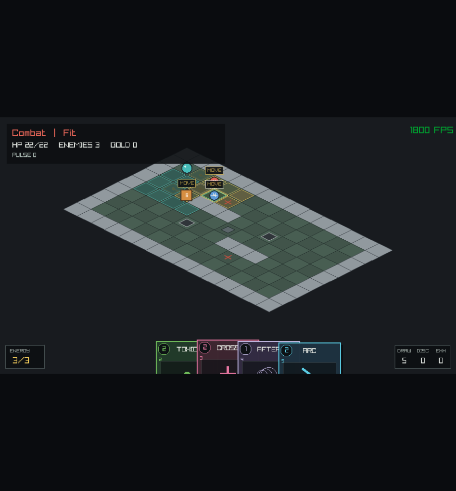

# Targeting System

Questa guida descrive l'autorita geometrica condivisa da preview e compilazione
delle carte. Il targeting calcola celle e ID, ma non applica danni e non modifica
la stanza. La trasformazione finale in effetti e descritta in
[Card System](CARD_SYSTEM.md); la loro risoluzione in
[Action System](ACTION_SYSTEM.md). La validazione di uno spostamento derivato
dalla carta appartiene invece al [Movement System](MOVEMENT_SYSTEM.md).

## Indice

- [Modello mentale](#modello-mentale)
- [Dati dichiarativi](#dati-dichiarativi)
- [Cast range](#cast-range)
- [Forme](#forme)
- [Clipping e ostacoli](#clipping-e-ostacoli)
- [Line of sight](#line-of-sight)
- [Actor stop](#actor-stop)
- [Risultato della query](#risultato-della-query)
- [Dalla query alla Action](#dalla-query-alla-action)
- [Targeting e movimento](#targeting-e-movimento)
- [Preview e compilazione](#preview-e-compilazione)
- [Carte implementate](#carte-implementate)
- [Smoke visuale](#smoke-visuale)
- [Errori](#errori)
- [Limiti fissi](#limiti-fissi)
- [Estendere il sistema](#estendere-il-sistema)

## Modello mentale

Il sistema separa due domande che non devono essere confuse:

```text
origin -- cast range --> anchor -- shape/radius --> affected cells
```

- `origin` e la posizione della sorgente quando viene eseguita la query;
- `cast_range` stabilisce dove puo essere collocata l'`anchor`;
- `shape` e `radius` costruiscono la footprint attorno o lungo quell'anchor;
- `enemy_ids` contiene i nemici vivi presenti nella footprint valida;
- il compilatore espande quegli ID in normali `Effect` dentro una `Action`.

Una carta che sposta un attore aggiunge una terza domanda, risolta dopo il
targeting: quale percorso puo compiere il mover dalla propria posizione alla
destinazione derivata? La risposta e una `Movement_Query`, non un'estensione
implicita della footprint.

Per esempio, `Firebomb` puo collocare l'anchor entro tre celle Chebyshev, ma la
sua footprint e un quadrato 3x3. Un nemico nella footprint puo quindi trovarsi
piu lontano di tre celle dal player: il range limita l'anchor, non ogni cella
colpita.

## Dati dichiarativi

Ogni definizione di carta contiene un solo `Targeting_Spec`:

```odin
Targeting_Spec :: struct {
	rule:                   Target_Rule,
	cast_range:             Targeting_Range,
	shape:                  Target_Shape,
	radius:                 int,
	requires_line_of_sight: bool,
	stops_on_wall:          bool,
	stops_on_actor:         bool,
}

Target_Request :: struct {
	anchor:     grid.Position,
	has_anchor: bool,
}
```

Le forme spaziali richiedono una request con anchor. Le carte con `shape ==
.None` ignorano l'anchor e usano l'origine. `card_target_request_at` centralizza
questa differenza per UI e test.

`targeting_spec_is_valid` rifiuta combinazioni senza una semantica definita:

- `Target_Rule.Any` non e ammesso nelle specifiche;
- una forma spaziale richiede una regola che usa l'anchor e un range geometrico;
- `None` accetta solo `None`, `Self` o `Player`, range nullo, raggio zero e flag
  geometrici disattivati;
- `Single` richiede raggio zero e non puo usare `stops_on_actor`;
- `Line` richiede metrica Chebyshev e raggio zero;
- `Cross` e `Square` richiedono raggio positivo, target `Cell` o
  `Walkable_Cell` e non possono usare `stops_on_actor`.

La validazione avviene prima di ogni query e anche quando vengono validate le
definizioni statiche delle carte.

## Cast range

```odin
Targeting_Range :: struct {
	metric:  Targeting_Range_Metric,
	minimum: int,
	maximum: int,
}
```

Le metriche implementate sono:

| Metrica | Distanza | Area dell'anchor |
|---|---|---|
| `Manhattan` | `abs(dx) + abs(dy)` | rombo |
| `Chebyshev` | `max(abs(dx), abs(dy))` | quadrato, diagonali incluse |
| `None` | nessuna misura | soltanto forme `None` |

Minimo e massimo sono inclusivi. Un range geometrico deve avere minimo non
negativo, massimo almeno uguale al minimo e massimo compreso fra 1 e
`MAX_TARGETING_RANGE`. Per `None`, minimo e massimo devono essere entrambi zero.

`targeting_range_contains` risponde soltanto alla domanda origin-anchor. Non
conosce footprint, muri, attori o regola del target.

Il validatore permette un minimo geometrico pari a zero. Per `Single`, `Cross` e
`Square`, un anchor uguale all'origine e valido e produce una footprint senza
celle di percorso. `Line` richiede invece una direzione e quindi non accetta
l'origine come anchor. Tutte le carte spaziali integrate usano minimo uno.

## Forme

### None

Non costruisce celle. L'anchor logica coincide con l'origine e
`anchor_reachable` e vero. Serve a carte self o globali come `Guard` e
`Toxic_Wave`.

### Single

La footprint contiene soltanto l'anchor, se la cella e interna e non e un
ostacolo statico. La regola decide poi se quella cella deve contenere un nemico,
una qualsiasi entita o soltanto essere calpestabile.

### Line

La linea parte dopo l'origine e include l'anchor. Sono valide esattamente otto
direzioni: quattro ortogonali e quattro diagonali perfette. Una pendenza come
`(2, 1)` restituisce `Shape_Not_Aligned`.

La sequenza ordinata e disponibile sia in `path` sia, dopo clipping e stop, in
`affected`. `path` descrive la traccia origin-anchor; `affected` descrive cio che
la carta colpisce realmente.

### Cross

Include l'anchor e i quattro bracci ortogonali fino a `radius`. Con raggio 1
produce cinque celle. Con `stops_on_wall`, ogni braccio viene controllato
separatamente: una cella bloccante e tutte quelle dietro vengono escluse, mentre
gli altri bracci restano validi.

### Square

Include il quadrato centrato sull'anchor. Con raggio 1 produce una footprint
3x3; in generale il lato e `2 * radius + 1`.

Le singole celle staticamente bloccate vengono escluse. `stops_on_wall` verifica
il percorso di cast fino all'anchor, ma non proietta ombre all'interno del
quadrato: le altre celle della footprint restano indipendenti.

## Clipping e ostacoli

Una footprint viene sempre ritagliata alla griglia. `append_shape_cell` ignora:

- coordinate fuori dai bounds;
- tile non calpestabili, inclusi muri e vuoto;
- ostacoli statici della stanza.

`Target_Cell_Set` impedisce i duplicati. L'inserimento e idempotente: se un
builder incontra di nuovo la stessa coordinata, la cella resta presente una sola
volta e non consuma capacita aggiuntiva.

Il clipping non rende automaticamente invalida la query. Una `Square` 3x3 sul
bordo puo quindi produrre sei o quattro celle valide. L'anchor, invece, deve
essere interna al livello e rispettare la propria `Target_Rule`; le carte ad area
attuali usano `Walkable_Cell`.

Player e nemici non sono ostacoli statici. Possono occupare una cella della
footprint e diventare destinatari senza rimuovere quella cella.

## Line of sight

`requires_line_of_sight` e `stops_on_wall` fanno controllare il percorso fra
origine e anchor. Il tracciamento include l'anchor ma esclude l'origine. Il primo
blocco statico produce:

```text
error       = Line_Of_Sight_Blocked
has_blocker = true
blocker     = posizione del blocco
```

Pareti, tile non calpestabili, ostacoli della stanza e oggetti con
`blocks_line_of_sight` bloccano la vista. Un oggetto targetable puo essere
l'endpoint del ray: occlude le celle successive, non se stesso. Gli
attori sono trasparenti alla LoS.

Un passo diagonale non puo passare nello spazio fra due blocchi ortogonali. Se
entrambe le celle laterali del passo sono bloccate, la query rifiuta il
"corner squeeze" e restituisce una delle due come `blocker`.

Per `Cross`, `stops_on_wall` viene usato anche dal clipping dei singoli bracci.
Per `Line`, un blocco sul percorso invalida il cast prima di costruire la
footprint.

## Actor stop

`stops_on_actor` e supportato soltanto da `Line`. Gli attori continuano a non
bloccare la line of sight, ma la footprint si ferma dopo aver incluso la prima
cella occupata da player o nemico.

```text
origin -> cella vuota -> nemico -> celle successive
affected: [cella vuota, nemico]
```

Con il flag disattivato, una linea attraversa tutti gli attori e raccoglie ogni
nemico incontrato. `Piercing_Ray` usa questa semantica perforante.

## Risultato della query

`evaluate_target_query` e pura e deterministica: legge la stanza, ma non cambia
posizioni, vita, fase, pulse, ostacoli o log eventi.

```odin
Target_Query_Result :: struct {
	error:              Target_Query_Error,
	origin:             grid.Position,
	anchor:             grid.Position,
	anchor_reachable:   bool,
	primary_target:     Target,
	has_primary_target: bool,
	affected:           Target_Cell_Set,
	path:               [MAX_TARGETING_PATH_CELLS]grid.Position,
	path_count:         int,
	blocker:            grid.Position,
	has_blocker:        bool,
	enemy_ids:          [MAX_ENEMIES_PER_ROOM]u32,
	enemy_count:        int,
}
```

I campi hanno ruoli distinti:

- `error == .None` e l'unico verdetto completo di validita;
- `anchor_reachable` indica che l'anchor ha superato bounds, cast range,
  eventuale allineamento e gli eventuali blocker richiesti dai flag, e che la
  sua cella non e staticamente bloccata; puo essere vero anche se manca il tipo
  di target primario richiesto, ed e quindi utile per disegnare la portata;
- `path` conserva la traccia origin-anchor e puo esistere anche quando la LoS e
  bloccata;
- `affected` e la footprint geometrica gia ritagliata;
- `primary_target` conserva la scelta dichiarata dalla regola;
- `enemy_ids` elenca i nemici nella footprint in ordine stabile di ID, non in
  ordine di storage nella dynamic array;
- `blocker` rende diagnostico e visualizzabile un fallimento di LoS.

La query controlla, in ordine, stanza, specifica, sorgente, anchor, bounds,
range, allineamento, percorso, blocker, footprint e target primario. Solo dopo
raccoglie gli ID dei nemici colpiti.

## Dalla query alla Action

Il flusso delle carte ad area e esplicito:

```text
Targeting_Spec + Target_Request
            |
            v
evaluate_target_query
            |
            +--> affected cells
            +--> enemy IDs in stable order
            |
            v
evaluate_card_targeting
            |
            +--> required_effect_count
            +--> optional Movement_Query
            |
            v
compile_card_action
            |
            v
one Action with ordered Effects
```

`Card_Target_Selector.Each_Affected_Enemy` crea un effetto per ogni ID della
query. Gli ID vengono risolti nuovamente dal normale action resolver, quindi una
rimozione unordered dei nemici non cambia i destinatari. `Each_Enemy` continua a
selezionare tutti i nemici vivi, indipendentemente dalla footprint.

La compilazione viene rifiutata prima di creare azioni parziali se non produce
effetti o supera `MAX_ACTION_EFFECTS`.

## Targeting e movimento

`Card_Target_Evaluation` conserva entrambe le autorita:

```odin
Card_Target_Evaluation :: struct {
	query:                 Target_Query_Result,
	movement:              Movement_Query,
	has_movement:          bool,
	movement_required:     bool,
	error:                 Card_Compile_Error,
	required_effect_count: int,
}
```

`Target_Query_Result` risponde a cast range, LoS, footprint e target primario.
Quando la definizione contiene un template `Move`, `evaluate_card_targeting`
deriva poi mover e destinazione ed esegue `query_entity_movement`.

La distinzione e necessaria per casi come `Shove`: l'anchor e il nemico scelto,
ma la landing e una cella oltre il nemico. Per `Dash`, invece, anchor e landing
coincidono, mentre percorso di targeting e percorso realmente attraversato
restano comunque dati di due query separate.

`movement_required` e vero quando `Move` e l'unico template della definizione.
Un fallimento rende allora l'intera valutazione `Target_Blocked` o
`Invalid_Target`. Nelle carte composte il risultato del movimento rimane
diagnostico e visualizzabile, ma gli altri effetti possono ancora essere
compilati e applicati.

## Preview e compilazione

La preview non reimplementa la geometria. Per ogni possibile anchor il renderer
costruisce una request con `card_target_request_at` e chiama
`evaluate_card_targeting`:

- teal per gli anchor con `query.anchor_reachable` o gia accettati dalla
  valutazione completa; il secondo caso permette a `Target_Rule.Cell` di
  puntare intenzionalmente una cella statica;
- ambra per percorso e footprint della cella puntata;
- teal per percorso e landing di movimento validi;
- verde per un anchor valido e pagabile;
- rosso per target invalido, carta non pagabile, landing invalida o blocker di
  targeting e movimento;
- anchor disegnato per ultimo, cosi la cella di rilascio resta leggibile.

`anchor_reachable` non significa automaticamente "carta giocabile". Per esempio,
un'area vuota puo avere geometria valida ma produrre `No_Effects`: resta parte
della portata teal, mentre la preview puntata diventa rossa.

Al rilascio, la UI converte il `primary_target` in un normale `Target` e chiama
`play_card`. `compile_card_action` ricostruisce la request con
`card_target_request_from_target` e riesegue `evaluate_card_targeting` prima di
creare gli effetti. Preview e compilazione condividono quindi la stessa funzione
autorevole; la preview non concede mai una giocata che il compilatore non
ricontrolli.

Il renderer legge `evaluation.query` ed `evaluation.movement` senza
reimplementare alcuna geometria. `card_drop_target` consuma la stessa
valutazione: per un `Dash` bloccato preview, drop e compilazione concordano e la
giocata non consuma energia, carta o pulse.

L'energia non appartiene alla query. Il renderer la usa per il colore, mentre
`play_card` la controlla e la paga nella transazione del deck.

## Carte implementate

| Carta | Cast range | Forma | Regole principali |
|---|---|---|---|
| `Strike` | Manhattan 1 | `Single` | avversario adiacente |
| `Arc_Bolt` | Manhattan 1-3 | `Single` | avversario, LoS statica |
| `Piercing_Ray` | Chebyshev 1-5 | `Line` | otto direzioni, attraversa attori, danno a ogni nemico nella linea |
| `Cross_Slash` | Manhattan 1-3 | `Cross`, raggio 1 | anchor calpestabile, LoS e bracci fermati dai muri |
| `Firebomb` | Chebyshev 1-3 | `Square`, raggio 1 | anchor calpestabile, LoS, footprint 3x3 |
| `Shove` | Manhattan 1 | `Single` | avversario o oggetto targetable adiacente; landing una cella lontano dal player |
| `Dash` | Chebyshev 1-3 | `Line` | anchor calpestabile; percorre ogni cella fino alla landing |
| `Grappling_Hook` | Chebyshev 2-4 | `Line` | avversario, LoS e actor stop; landing adiacente al player |

Le carte `Guard`, `Toxic_Wave`, `Thorn_Coat`, `Afterimage` e `Counter_Rune` usano
`shape == .None`.

## Smoke visuale



La scena deterministica usata per verificare l'overlay si genera con:

```sh
odin run src -- --smoke-targeting
```

Il flag porta `Firebomb` in drag, posiziona tre nemici nella footprint con uno
esattamente sull'anchor puntata, salva `odin_pp_advanced_targeting.png` dopo tre
frame e termina.

## Errori

`Target_Query_Error` distingue specifica, sorgente, anchor, bounds, range,
allineamento, LoS, target primario e capacita. Il compilatore traduce gli errori
geometrici in `Card_Compile_Error`:

| Query | Compilazione carta |
|---|---|
| `None` | `None` |
| `Invalid_Room` | `Invalid_Room` |
| `Anchor_Out_Of_Range` | `Target_Out_Of_Range` |
| `Line_Of_Sight_Blocked` | `Target_Blocked` |
| `Invalid_Spec` | `Invalid_Definition` |
| sorgente invalida, anchor mancante o fuori bounds | `Invalid_Target` |
| forma non allineata o target primario invalido | `Invalid_Target` |
| `Capacity_Exceeded` | `Invalid_Target` |

`No_Effects` e `Too_Many_Effects` vengono aggiunti da
`evaluate_card_targeting`, dopo una query geometrica riuscita.

Se e presente un movimento obbligatorio, `Static_Blocker`, `Actor_Blocker` e
`Object_Blocker` diventano `Target_Blocked`; bounds, allineamento, lunghezza o
mover invalidi diventano `Invalid_Target`. Il dettaglio originale resta
disponibile in `Card_Target_Evaluation.movement` per la preview.

## Limiti fissi

Il targeting non alloca durante la query. I budget correnti sono:

| Limite | Valore | Uso |
|---|---:|---|
| `MAX_TARGETING_RANGE` | 12 | massimo cast range |
| `MAX_TARGETING_RADIUS` | 4 | massimo raggio di forma |
| `MAX_TARGETING_PATH_CELLS` | 12 | celle della traccia |
| `MAX_MOVEMENT_PATH_CELLS` | 12 | celle attraversate da un movimento |
| `MAX_TARGETING_SHAPE_CELLS` | 81 | footprint massima 9x9 |
| `MAX_ENEMIES_PER_ROOM` | 32 | ID nemici raccolti dalla query |
| `MAX_ACTION_EFFECTS` | 32 | effetti concreti in una Action |
| `MAX_CARD_DEFINITION_EFFECTS` | 4 | template in una definizione carta |

Superare un budget restituisce un errore o fa fallire la validazione; non tronca
silenziosamente una giocata valida.

## Estendere il sistema

Per aggiungere una forma o una nuova carta:

1. definire una semantica precisa per anchor, footprint e clipping;
2. aggiornare `targeting_spec_is_valid` prima del builder;
3. costruire le celle soltanto in `evaluate_target_query` e helper chiamati da
   essa;
4. mantenere ordine deterministico e storage fisso;
5. usare gli ID raccolti, mai indici persistenti di `Room.enemies`;
6. far consumare a preview e compilazione la stessa valutazione, incluse le
   eventuali `Movement_Query`;
7. aggiungere test per bounds, muri, corner squeeze, attori, ordine ID e
   immutabilita della stanza.

Il renderer deve continuare a visualizzare `Target_Query_Result`, non a
ricostruire regole geometriche proprie.
