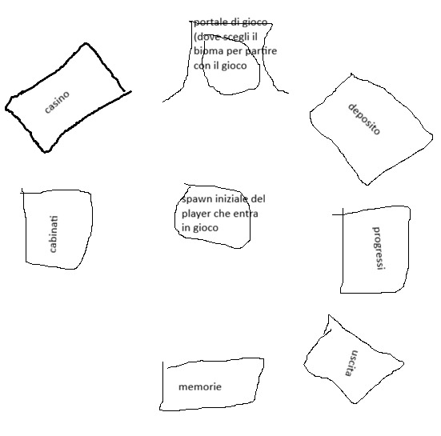
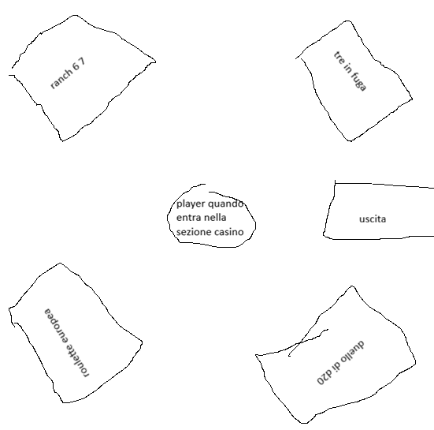
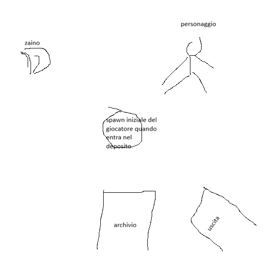
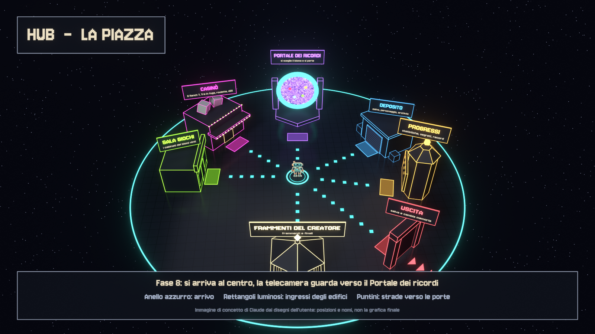
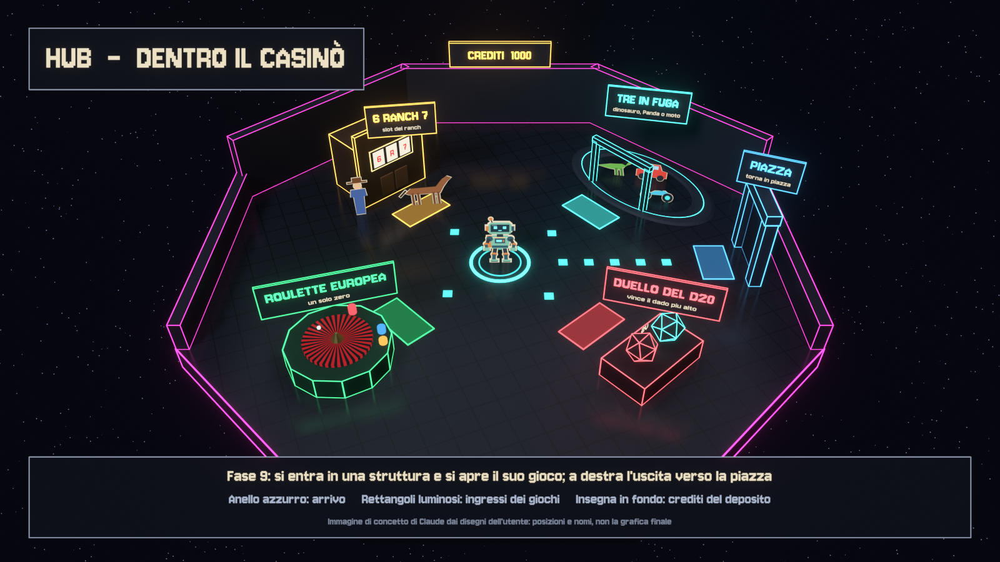
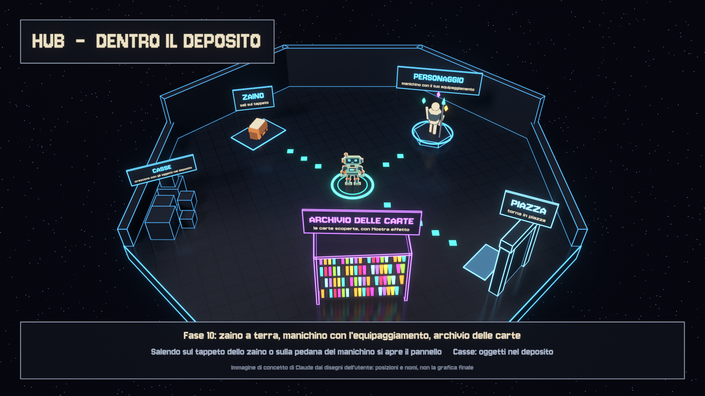
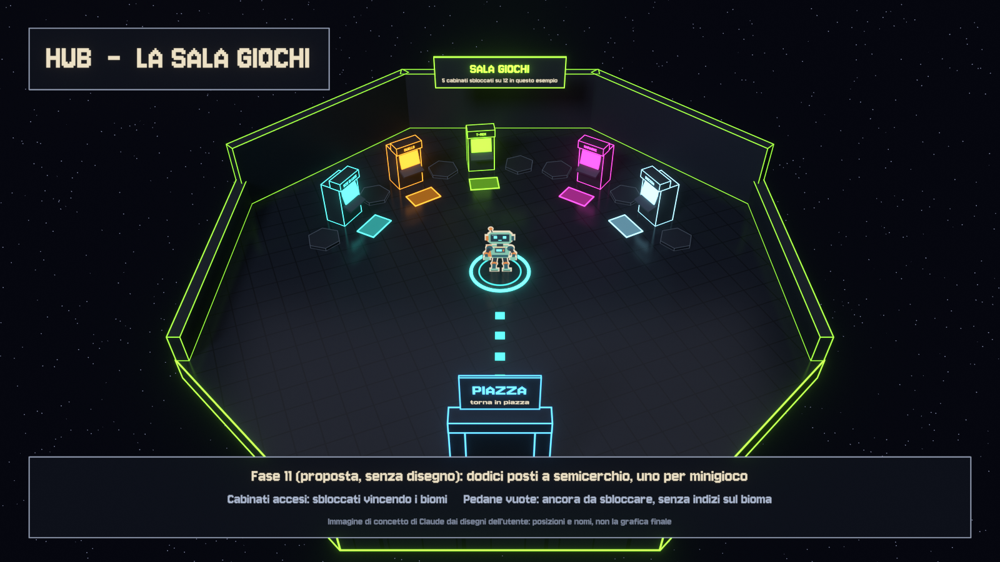

# Piano di lavoro: bersagli, profondità e strutture sulla griglia

Scritto il 23 ottobre 2026 sul ramo `piano-griglia`, partito da
`carte-laboratorio` (commit `2ed075d`: `main` `a766d81` più le carte della
Prova meccaniche). Il ramo non contiene i 1000 crediti iniziali, che stanno su
`crediti-iniziali-casino`.

Il piano raccoglie quattro richieste dell'utente, divise in fasi indipendenti:

1. **Bersagli in evidenza.** Mentre scegli una carta, la casella del raggio
   con sopra un nemico che la carta colpirebbe si accende in modo diverso, con
   un effetto che parte dalla casella sotto il nemico.
2. **Profondità della griglia.** Caselle rialzate, gradini, dirupi e caverne.
   Nelle Montagne innevate, una montagna da scalare lungo una spirale di
   gradini fino alla cima.
3. **Strutture su più caselle.** Un modo per posare sulla griglia oggetti ed
   edifici complessi.
4. **L'hub in 3D.** Dopo la scelta della memoria, l'hub diventa un mondo in
   cui il robot cammina: una piazza con gli edifici, e dentro casinò, deposito
   e sala giochi altre zone da percorrere. La richiesta è accompagnata da tre
   disegni dell'utente.

Le fasi si eseguono **una alla volta, solo su comando dell'utente**. Le regole
per Claude sono nella sezione 1 e vanno lette prima di ogni fase. L'ordine
consigliato è nella scaletta, subito dopo la tabella.

## Stato delle fasi

La tabella è in ordine di priorità, cioè l'ordine della scaletta qui sotto. Il
numero della fase resta quello della sua sezione.

| Priorità | Fase | Contenuto | Dipende da | Stato | Commit |
|---|---|---|---|---|---|
| 0 | 0 | Test affidabili su Windows (proposta di Claude, approvata dall'utente) | — | Fatta | vedi Esito |
| 1 | 1 | Bersagli in evidenza | — | Fatta | vedi Esito |
| 2 | 8 | Hub in 3D: la piazza, il robot che cammina, gli edifici | — | Fatta | vedi Esito |
| 3 | 9 | Hub in 3D: dentro il casinò | 8 | Fatta | vedi Esito |
| 4 | 10 | Hub in 3D: dentro il deposito | 8 | Da fare | — |
| 5 | 11 | Hub in 3D: dentro la sala giochi | 8 | Da fare | — |
| 6 | 2 | Altezze nel laboratorio: dati, regole, grafica, puntamento | — | Fatta | vedi Esito |
| 7 | 6 | Strutture su più caselle: edifici e oggetti complessi, edifici trasparenti avvicinandosi | — (meglio dopo la 2) | Da fare | — |
| 8 | 3 | Altezze nelle spedizioni: renderer, mappe, salvataggi, prestazioni | 2 | Da fare | — |
| 9 | 4 | La montagna a spirale delle Montagne innevate | 2, 3 | Da fare | — |
| 10 | 5 | Caverne | 2 (3 e 4 per metterle nei biomi) | Da fare | — |
| 11 | 7 | Posa delle strutture da parte del giocatore | 6 | Facoltativa: si fa solo se l'utente la conferma | — |

## Scaletta: cosa sviluppare prima

Ordine consigliato da Claude il 23 ottobre 2026. È l'ordine della tabella, e
«Passa alla prossima fase» lo segue. L'utente può sempre cambiarlo nominando
una fase.

**I criteri:**
- **Valore subito:** prima ciò che il giocatore sente in ogni partita.
- **Rischio:** prima i lavori piccoli e sicuri. Le parti che toccano il
  renderer delle spedizioni e le prestazioni vengono dopo che le regole sono
  collaudate nel laboratorio.
- **Dipendenze:** nessuna fase arriva prima di ciò che le serve.
- **Niente lavoro rifatto:** per esempio le strutture vengono dopo le altezze,
  così le piante nascono con piani e gradini.
- **Verifiche affidabili:** ogni fase si chiude con la suite di test, che dopo
  la Fase 0 su Windows arriva in fondo.

**La scaletta.** Le dimensioni sono relative alle altre fasi del piano.

| Priorità | Fase | Perché in questa posizione | Dimensione | Rischio |
|---|---|---|---|---|
| 0 | Fase 0: test affidabili su Windows (fatta il 23 ottobre 2026) | Ogni fase si chiude con la suite completa, che prima su Windows andava in crash a metà e lasciava test non eseguiti. Ora arriva in fondo (sezione 1.5), così ogni verifica successiva è più veloce e completa. | piccola | basso |
| 1 | Fase 1: bersagli in evidenza | È la prima richiesta dell'utente e migliora subito ogni scontro. Non dipende da niente e non tocca il resto. | piccola | basso |
| 2 | Fase 8: hub, la piazza | È il cambiamento più visibile, perché ogni partita parte da lì. Disegni e immagini sono pronti, quindi resta poco da decidere. Non tocca combattimento né spedizioni. | grande | medio: cambia cosa succede dopo la scelta della memoria |
| 3 | Fase 9: hub, il casinò | Completa l'hub finché il lavoro della Fase 8 è fresco, e costruisce il passaggio tra zone che riusano le Fasi 10 e 11. | media | basso |
| 4 | Fase 10: hub, il deposito | I tre pannelli (zaino, personaggio, archivio) esistono già: si costruisce la sala attorno. | media | basso |
| 5 | Fase 11: hub, la sala giochi | Chiude l'hub. Serve prima la risposta sulla disposizione, perché non c'è un disegno. | piccola o media | basso |
| 6 | Fase 2: altezze nel laboratorio | Sono le fondamenta della profondità: cambiano movimento, vista e IA, ma la grafica nuova resta nel laboratorio. Sblocca le Fasi 3, 4 e 5 e le strutture con piani. | grande | medio |
| 7 | Fase 6: strutture e trasparenza | Viene dopo le altezze, così le piante nascono con piani e gradini. La sua trasparenza si può poi estendere agli edifici della piazza (domanda 7 della Fase 8). | grande | medio |
| 8 | Fase 3: altezze nelle spedizioni | È la parte più rischiosa: renderer delle spedizioni, prestazioni e salvataggi. Meglio farla quando regole e grafica sono già collaudate nel laboratorio. | molto grande | alto |
| 9 | Fase 4: la montagna a spirale | È il traguardo della profondità, e serve la Fase 3. | media | medio: vedere il robot dietro la montagna |
| 10 | Fase 5: caverne | Le grotte con volta poggiano su altezze e montagna. | media | medio |
| 11 | Fase 7: posa da parte del giocatore | È facoltativa: si fa solo se l'utente la conferma alla Fase 6. | media | basso |

**Se la priorità è un'altra:**
- **La montagna prima di tutto:** 1 → 2 → 3 → 4 → 5, poi l'hub e le
  strutture. Alla montagna si arriva prima, ma passando subito dalla parte più
  rischiosa, la Fase 3.
- **Gli edifici trasparenti prima:** 1 → 2 → 6, poi il resto.
- **Solo l'hub:** le Fasi 8 → 9 → 10 → 11 non dipendono da nient'altro.

**Prima delle fasi grandi** conviene fare un pull di `main` e controllare se
gli stessi file sono cambiati. Le Fasi 3, 6 e 8–11 toccano il renderer delle
spedizioni e l'hub, su cui lavora anche 0xdokkan.

## 1. Comandi per Claude

### 1.1 Come si avvia una fase

L'utente scrive uno di questi comandi:

```text
Esegui la Fase 1 di docs/piano-griglia.md
```

```text
Passa alla prossima fase di docs/piano-griglia.md
```

Ogni fase ha anche il suo comando pronto, alla fine della sua sezione.
- **Prossima fase.** La tabella è in ordine di priorità, quindi «prossima
  fase» significa la prima riga con stato `Da fare`.
- **Fasi `Proposta` e `Facoltativa`.** Si eseguono solo se l'utente le nomina
  o le conferma.

### 1.2 Regole per ogni fase

1. **Una fase sola.** Esegui solo la fase richiesta. Non iniziare, non
   preparare e non affidare ad altri (sessioni nuove, agenti in background,
   workflow) nessun'altra fase. Questa regola vale anche se la memoria dice
   di concatenare le fasi: per questo piano l'utente ha chiesto di fermarsi
   dopo ognuna.
2. **Prima di scrivere codice.**
   - `git status` deve essere pulito. Lavora sul ramo `piano-griglia`, o su
     quello che indica l'utente. Mai commit su `main`.
   - Rileggi la sezione della fase e controlla che i file e le funzioni citati
     esistano ancora: il piano descrive il codice del 23 ottobre 2026. Se
     qualcosa è cambiato, adatta il lavoro e scrivilo nell'esito della fase.
   - Fai all'utente, **tutte insieme**, le domande della voce «Da chiedere
     prima di iniziare», con la raccomandazione come prima opzione. Aspetta
     le risposte. Se una risposta cambia il progetto, aggiorna prima questo
     documento.
   - Segna la fase `In corso` nella tabella.
3. **Durante la fase** valgono le regole del progetto:
   - rispondi in italiano;
   - le meccaniche nuove si provano prima in Prova meccaniche e passano al
     gioco normale solo dove la fase lo dice;
   - suoni e disegni si creano da codice (`tools/audio`, `tools/art`), mai
     scaricati;
   - i file di prova vanno nella scratchpad, non nel repo;
   - compilatore: `C:\Users\lukeg\OneDrive\Desktop\odin-dev-2026-10\dist\odin.exe`
     (quello nel PATH è troppo vecchio);
   - dopo ogni modifica piccola: `odin check src -vet -strict-style` e i test
     del pacchetto toccato.
4. **Verifica di fine fase.** È obbligatoria; i comandi sono nella sezione
   1.4. Servono:
   - check normale e senza assert;
   - suite completa, confrontata con i fallimenti già noti (sezione 1.5):
     nessun test nuovo deve fallire;
   - build del gioco;
   - smoke del laboratorio con gli atti della fase, guardando davvero le
     catture.
5. **Chiusura.**
   - Aggiorna `CHANGELOG.md`, i documenti che la fase nomina, la tabella
     (stato `Fatta`, commit) e la voce «Esito» della fase.
   - Fai il commit sul ramo, con un messaggio in italiano che finisce con la
     riga `Co-Authored-By` di Claude. Niente push.
6. **Stop.** Scrivi il resoconto con il modello della sezione 1.3 e chiudi
   con la domanda sulla fase successiva. Poi **fermati**. Non iniziare la
   fase dopo, nemmeno in parte, finché l'utente non risponde di sì.
7. **Se qualcosa si blocca** (una decisione che manca, test che non passano,
   un'idea che non regge): fermati, spiega e chiedi. Non saltare a un'altra
   fase per guadagnare tempo.
8. **Se l'utente cambia idea:** prima aggiorna questo documento (la sezione
   della fase e la tabella), poi lavora.

### 1.3 Modello del messaggio di chiusura

```text
Fase N — <titolo>: completata (commit <hash> sul ramo piano-griglia).

Cosa è cambiato: …
Verifiche: check ok (anche senza assert); test <passati>/<totali>, con i soli
fallimenti già noti; build ok; smoke del laboratorio: atti <…>, catture <…>.
Non verificato: …
Decisioni prese: …

Vuoi che passi alla Fase N+1 — <titolo>?
```

Dopo questa domanda il turno finisce.

### 1.4 Comandi delle verifiche

Da Git Bash, nella cartella `odin_pp`. `$S` è la scratchpad della sessione.

```bash
ODIN="/c/Users/lukeg/OneDrive/Desktop/odin-dev-2026-10/dist/odin.exe"
"$ODIN" check src -vet -strict-style
"$ODIN" check src -vet -strict-style -disable-assert
"$ODIN" test src -all-packages -define:ODIN_TEST_THREADS=1 -define:ODIN_TEST_FULL=false -o:none -out:"$S/tests.exe"
"$ODIN" build src -o:none -out:"$S/odin_pp.exe"
"$S/odin_pp.exe" --smoke-mechanics-lab
```

Le catture finiscono in `build/captures` (cartella ignorata da git). Lo smoke
completo del laboratorio dura più di otto minuti: durante il lavoro si
possono far girare solo gli atti della fase, ma a fine fase va completato.
Nelle Fasi 8–11 si aggiungono gli smoke dell'hub: `--smoke-hub`,
`--smoke-expedition` e il nuovo `--smoke-hub-world`.

### 1.5 Test su Windows (dopo la Fase 0, 23 ottobre 2026)

Dopo la Fase 0 la suite completa passa su Windows senza flag speciali:
`.\scripts\check.ps1` finisce con 1529 test verdi, due volte (con e senza
assert), più le due build.

- **Nessun fallimento noto.** I dodici di prima, il crash a metà della suite e
  i pacchetti che da soli non arrivavano in fondo avevano tre cause, tutte
  risolte (sezione 16): percorsi `/private/tmp`, stack di Windows troppo
  piccolo per decodificare lo snapshot e una tolleranza troppo stretta.
- **Ogni pacchetto si lancia da solo** con `odin test src/<pacchetto>`.
- **Se un test nuovo decodifica lo snapshot della spedizione** (1,3 MB) in un
  pacchetto che non importa `src/engine/teststack`, su Windows va in crash.
  Basta aggiungere `import _ "../engine/teststack"` in un suo file di test.
- **I test non devono scrivere in `/private/tmp`**, ma nella cartella
  temporanea del sistema (`os.temp_directory`).

## 2. Fase 1 — Bersagli in evidenza

### Cosa chiede l'utente

Mentre il giocatore ha una carta in mano e deve decidere se usarla, sulla
griglia compare in blu il raggio d'azione. Oggi però è difficile capire quando
la carta colpirebbe davvero un nemico. Ogni casella del raggio con sopra un
nemico che la carta colpirebbe, o su cui avrebbe effetto, deve accendersi in
un colore molto visibile. In più serve un piccolo effetto che parte dalla
casella sotto il nemico e dice «questo lo puoi colpire».

È una correzione dell'HUD, quindi vale in tutto il gioco (spedizioni e
laboratorio). Si prova prima nella Prova meccaniche.

### Come funziona oggi

Righe del 23 ottobre 2026.

- **Il calcolo del raggio** è in `prepare_card_range_preview`
  (`src/render/card_range_light.odin:38-84`). Lo chiama `draw_tactical_world`
  una volta per frame (`src/render/tactical_renderer.odin:566`).
  - Per le carte che puntano una casella esamina un quadrato di raggio
    `min(cast_range.maximum, 12)` attorno al giocatore. Accende la casella se
    `game.evaluate_card_targeting` la accetta.
  - Per le carte su di sé accende solo la casella del giocatore; l'Onda
    Tossica aggiunge i nemici nella sua area.
  - Una seconda valutazione, sulla casella sotto il mouse, finisce in
    `preview.hover`.
- **I dati** stanno in `Card_Range_Preview` (`card_range_light.odin:16-22`):
  `cells: [25*25]bool` e `hover`, una `Card_Target_Evaluation` con le celle
  colpite, il percorso e fino a 32 `enemy_ids`.
- **Il disegno** avviene in due modi.
  - Nel laboratorio il pavimento si tinge di blu, in `card_range_floor_color`
    (`card_range_light.odin:98-126`).
  - In tutte e due le modalità c'è una luce sopra il pavimento,
    `draw_card_range_light` (`card_range_light.odin:196-241`), chiamata da
    `tactical_renderer.odin:648` prima di minacce e intenti.
  - Nelle spedizioni il pavimento è un piano con shader che non riceve
    l'anteprima (`src/render/expedition_floor.odin:383-419`), quindi lì si
    vede solo la luce.
- **I colori dell'anteprima** (`card_range_light.odin:87-93`) sono raggio blu
  `{76,164,232}`, effetto ambra `{242,183,85}`, bersaglio menta
  `{130,245,213}` e non valido rosso `{242,91,100}`. La pulsazione è
  `0.92+0.08*sin(t*2.4)`, cioè quasi ferma.
- **Quando si vede:** solo con una carta trascinata o selezionata, mai al
  solo passaggio del mouse (`src/run/gameplay_runtime.odin:29-34`).
- **Segni simili esistono già, ma solo per poche carte:**
  - il mirino del Lazzo e del Pinball (`draw_aim_reticle`,
    `src/render/player_charges.odin:243`);
  - i nemici sulla linea del Cannone (`src/render/arsenal.odin:744-757`);
  - tutti i nemici per l'Inondazione (`src/game/flood.odin:233-236`).
- **Attenzione:** un nemico in `enemy_ids` non è per forza colpito. Decide il
  bersaglio di ogni effetto: per esempio lo Scatto elenca i nemici sulla sua
  linea ma non li tocca. Il piano vero degli effetti è
  `build_card_target_plan` (`src/game/card.odin:1884-1921`), che è privato.
  Una sua copia pubblica esiste in `src/combatdebug/telemetry.odin:266-283`.

### Progetto

**Quali nemici si accendono.** Un nemico è «colpibile» se, in questo momento,
esiste almeno una giocata valida della carta che lo tocca davvero: danno,
spinta, stato o qualunque altro effetto. Lo decide il piano degli effetti,
non solo le celle. Restano spenti i nemici:
- fuori gioco;
- nascosti dalla nebbia;
- dietro un muro, per le carte con linea di vista;
- fuori raggio.

Come si comportano i vari tipi di carta:
- **Carte su una casella o su un nemico:** il nemico è su una casella del
  raggio e la giocata lì lo colpisce. È il caso che ha descritto l'utente.
- **Carte ad area, in linea o su tutta la stanza** (Bomba incendiaria,
  Cannone, Inondazione, Buco Nero…): si accendono anche i nemici che l'area
  di una giocata valida prenderebbe. Da confermare con la domanda 2.
- **Carte con esito casuale** (le colonne di Bomb Marley, il dado del
  Dinosauro): nessun segno, perché non si sa chi verrà colpito. Anche questo
  dipende dalla domanda 2.
- **Puntando il mouse su una casella**, i nemici che *quella* giocata
  colpirebbe passano allo stato «agganciato»: il segno si fa più forte e un
  anello si allarga una volta.

**Il calcolo sta nel gioco, non nel renderer.** Serve una funzione pubblica
in `src/game` (per esempio `card_hittable_enemies`), pura e testabile.
- Riusa la stessa valutazione del raggio e il piano degli effetti. Il piano
  va reso pubblico (tutto o in parte), invece di copiarlo una terza volta.
- Il renderer la chiama in `prepare_card_range_preview` e mette il risultato
  in `Card_Range_Preview`: una maschera per cella più l'elenco degli id.
- Costa al massimo 625 valutazioni per frame, quante ne fa già il raggio. Se
  servisse, il risultato si conserva finché non cambiano carta, posizioni e
  battito.

**Il colore: perché non ne basta uno solo.**
- Quattro tinte sono già prese dall'anteprima: blu (raggio), ambra
  (effetto), menta (bersaglio), rosso (non valido).
- Gli scontri si svolgono su piastrelle tinte del colore del bioma, e le
  dodici tinte (`src/expedition/world.odin:77-89`) coprono quasi tutta la
  ruota: rosso del Cyber, arancio del Far West e dell'Inferno, oro
  dell'Egitto, verde della Giungla, azzurro della Neve, magenta della City,
  viola dello Spazio, rosa del Cielo.
- Quindi qualunque tinta fissa si confonde in almeno un bioma.
- Le guide sull'accessibilità dicono di non affidare il significato al solo
  colore, ma di usare anche forma, luminosità e movimento (fonti nella
  sezione 14).

Per questo il segno è fatto di quattro cose insieme:
1. **Luminosità:** il cuore della casella è bianco caldo, il punto più chiaro
   della scena, e pulsa in modo netto (non quasi fermo come oggi).
2. **Contorno d'inchiostro:** un bordo scuro e spesso, nello stile cartoncino
   del gioco (`src/render/comic_outline.odin`), che stacca il bianco da
   qualunque pavimento.
3. **Forma:** un mirino a quattro angoli che respira, lo stesso disegno del
   Lazzo e del Pinball (`draw_aim_reticle`). Così il segno «bersaglio» è uno
   solo in tutto il gioco.
4. **Alone di contrasto:** un alone saturo, di una tinta lontana sia da quella
   del bioma sia dai quattro colori dell'anteprima.
   - Un calcolo del 23 ottobre lo conferma: il **viola elettrico**
     `{170,90,255}` resta ad almeno 40° di tinta da tutti i colori in gioco,
     nel laboratorio e in undici biomi.
   - Nello Spazio, dove il viola è la tinta del bioma, serve il **verde
     acido** `{190,255,60}`.
   - Un test tiene questa distanza minima in tutti i biomi.

**L'effetto visivo** parte dalla casella sotto il nemico:
- la casella pulsa (cuore bianco più alone);
- una colonna di scintille sale dalla casella fino al petto del nemico e
  svanisce. È calcolata dal tempo e dalla posizione, senza stato, come i
  pulviscoli di `draw_diorama_accents` (`src/render/diorama_scene.odin:221`);
- gli angoli del mirino si stringono e si allargano piano;
- quando il mouse aggancia quel nemico, gli angoli si chiudono, la luce è
  piena e un anello si allarga una volta. Si possono riusare `marley_glow` e
  `marley_frame` (`src/render/marley.odin:120,149`).

L'animazione usa il tempo del mondo (`tactical_world_time`), così si ferma
con il mondo. Oggi la luce del raggio usa invece l'orologio degli sprite.

**Dove si disegna:** nella stessa passata della luce del raggio
(`tactical_renderer.odin:648`), subito dopo il blu.
- Così vale nel laboratorio, nelle spedizioni e nel film di Mostra effetto.
- Le scintille vanno in fusione additiva.
- Gli intenti dei nemici restano sopra e leggibili.

### Da chiedere prima di iniziare

1. **Colore.**
   - (Consigliato) Bianco con contorno d'inchiostro e alone viola elettrico,
     verde acido nello Spazio.
   - Oppure un solo colore fisso per tutto (e quale).
   - Oppure un colore che sceglie l'utente.
2. **Quali nemici.**
   - (Consigliato) Tutti quelli che una giocata valida colpirebbe con
     certezza, anche con aree, linee e carte su tutta la stanza; esclusi gli
     effetti casuali.
   - Oppure solo quelli in piedi su una casella del raggio.
   - Oppure anche quelli che una carta casuale *potrebbe* colpire, con un
     segno più tenue.
3. **Lazzo e Pinball.**
   - (Consigliato) Usano il nuovo segno al posto del loro mirino, così il
     linguaggio è uno solo.
   - Oppure tengono il loro.
4. **Anteprima al passaggio del mouse sulla carta.**
   - (Consigliato) Resta come oggi: raggio e bersagli solo con la carta
     trascinata o selezionata.
   - Oppure compaiono già al passaggio del mouse, più tenui.

### Passi

1. **Gioco:** funzione pubblica dei nemici colpibili, con il piano degli
   effetti condiviso, e i suoi test.
2. **Renderer:**
   - i risultati in `Card_Range_Preview`;
   - il segno sulla casella (cuore, contorno, mirino, alone);
   - le scintille;
   - lo stato agganciato.
3. **Colori:** tabella dei colori di contrasto per bioma e per il
   laboratorio, con il suo test.
4. **Laboratorio:** un atto nuovo dello smoke, «bersagli», con queste
   catture:
   - carta da mischia con un nemico vicino;
   - carta a distanza con un nemico dietro un muro (deve restare spento);
   - carta ad area;
   - mouse sopra un bersaglio (agganciato);
   - Cannone e Inondazione.
5. **Spedizione:** catture di uno scontro con una carta selezionata, in almeno
   tre biomi di tinte diverse (Neve, Far West, Giungla). Oggi nessuno smoke di
   spedizione tiene una carta in mano, quindi va aggiunto.
6. **Documenti:**
   - `docs/presentazione.md` (HUD);
   - `docs/regole/carte.md` (targeting);
   - `CHANGELOG.md`.

### Test e verifiche

- **Copertura:** per ogni carta del catalogo, i nemici accesi coincidono con
  il piano degli effetti. Il modello è il test di
  `src/render/card_range_light_test.odin:54`, che già confronta le celle del
  raggio con il targeting del gioco.
- **Casi singoli:**
  - nemico dietro un muro: spento per le carte con linea di vista;
  - fuori raggio, fuori gioco, nascosto dalla nebbia: spento;
  - Scatto (elenca ma non colpisce): spento;
  - Spinta (colpisce): acceso;
  - carte su di sé con area.
- **Aggancio:** lo stato agganciato coincide con `hover.enemy_ids` filtrati dal
  piano degli effetti.
- **Colore:** l'alone resta ad almeno 40° di tinta dagli altri colori in ogni
  bioma.
- **Prestazioni:** con una carta selezionata, il tempo di frame nel
  laboratorio e in spedizione non peggiora in modo visibile.

### Fatto quando

- Nel laboratorio e in spedizione, con qualunque carta selezionata:
  - ogni nemico colpibile ha la casella accesa e le scintille;
  - gli altri restano spenti;
  - puntando il mouse, il bersaglio si aggancia.
- Le catture lo mostrano in tre biomi diversi.
- Le verifiche della sezione 1.4 sono tutte a posto.

### Comando

```text
Esegui la Fase 1 di docs/piano-griglia.md (Bersagli in evidenza). Segui le
regole della sezione 1: fammi prima le domande della fase e fermati alla fine.
```

### Esito

Fatta il 23 ottobre 2026 sul ramo `piano-griglia`.

**Risposte dell'utente alle domande della fase**
1. **Colore:** bianco con alone viola elettrico (verde acido nello Spazio).
2. **Quali nemici:** tutti quelli colpiti con certezza, esclusi gli effetti
   casuali.
3. **Lazzo e Pinball:** usano il nuovo segno.
4. **Passaggio del mouse sulla carta:** sì, più tenue. (Il piano consigliava il
   contrario; vale la scelta dell'utente.)

**Cosa è stato fatto**
- **Gioco:** `game.card_hit_enemies` (in `src/game/card.odin`) dice quali nemici
  una giocata valida colpirebbe davvero, con lo stesso piano degli effetti della
  giocata. Eccezione calcolata a parte: l'Inondazione segna tutti i nemici in
  gioco. Cinque test nuovi in `src/game/card_hit_test.odin`.
- **Renderer:** `src/render/card_hit_mark.odin` disegna il segno nel passaggio
  della luce del raggio (nucleo quasi bianco che pulsa, contorno d'inchiostro,
  angoli, alone, anello che si apre una volta) e, dopo gli sprite, un fascio di
  luce con le scintille. `Card_Range_Preview` ha ora l'elenco dei nemici
  colpibili e lo stato «tenue».
- **Cannone e Buco Nero:** i nemici sulla linea e nel 3×3 si segnano con il
  puntatore sulla casella. Il vecchio segno di Cannone, Inondazione, Lazzo e
  Pinball sui nemici è stato tolto.
- **Passaggio del mouse:** `draw_tactical_world` ha un parametro `hover_card`
  e le due scene lo riempiono con `hovered_preview_card_id`.
- **Colore per bioma:** l'alone sceglie tra viola e verde acido (funzione
  `card_hit_halo_color`); un test verifica 40° di tinta di distanza da tutti i
  colori in ogni bioma.
- **Verifiche visive:** nuovo atto `mechanics_lab_hit_marks` nello smoke del
  laboratorio e quattro scontri nello smoke della spedizione (Neve, Far West,
  Giungla, Spazio).
- **Documenti:** `docs/presentazione.md`, `docs/regole/carte.md`,
  `docs/verifica.md`, `docs/direzione-implementazione.md` e `CHANGELOG.md`.

**Verifiche**
- `.\scripts\check.ps1` completo: 1538 test verdi, con e senza assert, e le
  due build.
- Smoke del laboratorio completo: exit 0 in 13 minuti, catture
  `odin_pp_mechanics_lab_hit_*.png`.
- Smoke della spedizione completo, con i quattro scontri nuovi:
  `odin_pp_expedition_bersagli_*.png`.

**Da sapere**
- L'animazione del segno usa l'orologio degli sprite e non quello del mondo
  (come previsto dal piano), perché la scelta delle carte avviene proprio quando
  il mondo è fermo.
- Le carte che colpiscono più tardi (ordigni posati) o a caso (Bomb Marley, dado
  del Dinosauro) non segnano nessun nemico.
- Per lavorare più in fretta ci sono due filtri solo di sviluppo:
  `ODIN_PP_LAB_ONLY=hit_marks` (laboratorio) e `ODIN_PP_SMOKE_ONLY=hits`
  (spedizione). La corsa completa resta in sequenza.
- Il passo «prestazioni» del piano non ha una misura dedicata: il segno fa al
  massimo una valutazione per casella già fatta dal raggio, più un piccolo
  calcolo per nemico segnato.

## 3. Fase 2 — Altezze nel laboratorio

### Cosa chiede l'utente, ed è possibile?

L'utente chiede se la griglia può diventare tridimensionale: non più solo
X e Y ma anche la profondità, con caselle rialzate, caverne in cui entrare e,
nelle Montagne innevate, una montagna da scalare lungo una spirale di
gradini.

**Sì, è possibile**, ma è il lavoro più profondo del piano, perché oggi il
gioco è piatto in ogni sua parte:
- le posizioni hanno due numeri;
- il pavimento è a quota zero;
- il mouse sceglie la casella colpendo il piano a quota zero;
- luci e riflessi delle spedizioni sono pensati per un piano.

Si può fare per gradi senza rompere niente. Ogni casella riceve un'altezza in
**gradini**, e 0 significa «come oggi». Con altezza 0 ovunque il gioco resta
identico, quindi tutti i test esistenti devono continuare a passare senza
modifiche.

Il lavoro è diviso in quattro fasi:
- **Fase 2:** dati, regole, grafica e mouse, nel laboratorio;
- **Fase 3:** le spedizioni;
- **Fase 4:** la montagna;
- **Fase 5:** le caverne.

Un 3D a più piani sovrapposti, cioè passare *sotto* un ponte su cui cammina
qualcun altro, non fa parte di questo piano: vedi la Fase 5.

### Come funziona oggi

- **Dati:**
  - `level.Tile` contiene solo il tipo; `Level` è in
    `src/level/level.odin:7-29`.
  - `set_tile` alza `geometry_revision`, che fa ricostruire la geometria
    delle spedizioni.
  - Esistono già altezze, ma solo disegnate: `Site_Cell.slab_height` e
    `wall_height` (`src/expedition/site_layout.odin:16-17`), con il commento
    «gli attori restano a terra».
- **Spostamenti:** passano tutti da una sola pipeline.
  - `query_entity_movement` e `query_movement_from` chiamano
    `movement_path_blocker`, che vede ogni coppia di caselle (precedente,
    successiva) (`src/game/movement.odin:102-243`).
  - Poi `apply_movement_effect` chiama `trigger_cell_entry` (righe 270-327).
  - La usano Spinta, Scatto, Rampino, le spinte dei nemici, l'Inondazione, il
    Buco Nero, la gravità, il vento, il Lazzo, il Pinball, il Movimento Ombra
    e il Dinosauro.
- **Passo del giocatore:**
  - `try_move_player` (`src/game/room.odin:817-907`);
  - la diagonale (`src/game/tactical_beat.odin:175-214`);
  - la schivata (`src/game/tactical_dodge.odin:26-38`).
- **IA dei nemici:**
  - la ricerca del percorso `rebuild_tactical_enemy_distances`
    (`src/game/enemy_tactical_ai.odin:127-181`) guarda le caselle, non i
    salti tra una e l'altra;
  - `planned_cell_is_available` (`src/game/enemy_intent.odin:108`);
  - `enemy_can_move_to` (`src/game/room.odin:802`).
- **Linea di vista:**
  - `trace_targeting_line` e `targeting_path_blocker`
    (`src/game/targeting.odin:207-271`);
  - `tactical_line_visible` (`src/game/tactical.odin:377-395`);
  - la linea dell'arciere (`src/game/enemy_intent.odin:144`) e il tiro a
    parabola (`src/game/enemy_tactical_ai.odin:66`);
  - una copia nel renderer, `tactical_presentation_opaque`
    (`src/render/tactical_renderer.odin:231-242`);
  - il colpo del First Person Shooter, che segue il pavimento a quota 0
    (`src/game/first_person.odin:322-374`).
- **Grafica del laboratorio:**
  - pavimento in `draw_tactical_tile` (`src/render/diorama_scene.odin:152-189`);
  - muri in `draw_diorama_wall` (righe 118-149) o con il kit
    (`src/render/diorama_kit.odin:177-221`);
  - personaggi a terra più un sollevamento (`src/render/living_card.odin:200-223`);
  - muri interni trasparenti e ordinati per profondità
    (`src/render/tactical_translucency.odin:110-172`);
  - bordo tagliato verso la telecamera (`diorama_scene.odin:27-47`).
- **Mouse:** un raggio contro il piano a quota 0
  (`tactical_renderer.odin:339-349`); personaggi e oggetti hanno la
  precedenza (righe 535-559).
- **Telecamera del laboratorio:** già ruota (trascinando col tasto centrale) e
  fa zoom con la rotella (`src/run/roguelike_scene.odin:260-263`). È utile per
  guardare le altezze.
- **Arena del laboratorio:** è 23×17, scritta a caratteri
  (`src/run/mechanics_practice.odin:32-48`). Il test
  `src/integration/mechanics_lab_test.odin:27-33` la vuole tutta piana e
  calpestabile, quindi le altezze vanno in una seconda arena.

### Regole proposte

- **Gradino.** È l'unità di altezza, disegnata alta 0,12 (una cella misura 1).
  - Regola di disegno dei livelli: dislivelli di 2 o 3 gradini sarebbero
    troppo bassi per leggersi come pareti, quindi le pareti si disegnano
    sempre da almeno 4 gradini (mezza cella).
- **Passo.** Tra due caselle vicine si passa se il dislivello è al massimo
  1 gradino, in salita o in discesa.
  - Da 2 gradini in su c'è una parete, che blocca il passo come un muro.
  - Una scala è una fila di caselle che salgono di 1.
- **Diagonale.** Si passa solo se anche le due caselle d'angolo rispettano il
  passo, così non si tagliano gli spigoli dei dirupi.
- **Spinte e tirate.**
  - Verso una casella più alta di 2 o più gradini, ci si ferma prima, come
    contro un muro (con l'eventuale danno d'urto che il gioco già dà).
  - Verso una casella più bassa di 2 o più gradini, si cade. Danno di caduta
    proposto: dislivello − 1, al massimo 10 (domanda 3).
  - Spingere giù un nemico da un'altura diventa una tattica, come in Triangle
    Strategy.
- **Linea di vista.**
  - Gli occhi sono a 0,7 sopra la propria casella, il bersaglio a 0,5 sopra la
    sua.
  - Una casella intermedia blocca se la sua cima supera la retta tra i due.
  - Dall'alto si vede in basso; dietro un dirupo non si vede.
- **Gittata.** Non cambia: resta Chebyshev o Manhattan sul piano. Un bonus
  d'altura (più gittata o più danno dall'alto, come nei giochi tattici
  citati) si aggiunge solo se l'utente lo vuole (domanda 4).
- **Nemici.** La ricerca del percorso usa la stessa regola di passo. All'inizio
  della fase va controllato quali nemici volano o attraversano (per esempio
  gli spettri gotici).
- **Dati.** Un'altezza per casella (`u8`, da 0 a 255 gradini) in
  `level.Level`.
  - Proposta: una griglia separata accanto alle tessere, con `height_at` e
    `set_height` che alzano `geometry_revision`.
  - In alternativa un campo in `level.Tile`. La griglia separata pesa meno nel
    salvataggio JSON (Fase 3).
  - Una sola funzione del passo, usata da tutti i punti elencati sopra.

### Grafica e mouse nel laboratorio

- **Caselle:** ognuna è disegnata alla sua quota, con facce laterali dove la
  vicina è più bassa, nello stile diorama e con gli stessi contorni. Muri e
  oggetti stanno sopra la casella.
- **Personaggi:** alla quota della loro casella, con salite e discese morbide
  (si riusa il sollevamento).
- **Anteprime:** raggio, bersagli della Fase 1, intenti e minacce si
  disegnano alla quota della casella.
- **Mouse:** il raggio dello schermo attraversa le colonne di caselle passo
  per passo sulla griglia e prende la prima cima o faccia che incontra.
  - È una funzione pura, testabile senza finestra.
  - Oggetti e personaggi continuano ad avere la precedenza.
- **Davanti ai personaggi:** i blocchi alti tra la telecamera e i personaggi
  diventano trasparenti, come i muri interni di oggi.

### Arena di prova

- È una seconda arena della Prova meccaniche, «Altezze», scelta con un tasto
  libero.
  - Il laboratorio usa già F4, F5, F6, F7, F8 e F10; F9 è dell'host e F11
    della finestra. F12 risulta libero, ma va controllato.
- Contiene:
  - un altopiano di 4 gradini con una scala di 4;
  - un dirupo senza scala;
  - una fossa;
  - un pilastro alto per provare la vista;
  - una piccola spirale di prova;
  - nemici su tutti e due i livelli.
- L'arena piatta di oggi resta com'è.

### Da chiedere prima di iniziare

1. **Altezza di un gradino disegnato.** 0,12 è il valore consigliato.
2. **Scendere da un dirupo camminando.**
   - (Consigliato) No, solo con una spinta.
   - Oppure sì, con danno di caduta.
3. **Danno di caduta.**
   - (Consigliato) Dislivello − 1, al massimo 10, uguale per robot e nemici.
   - Oppure un'altra formula.
4. **Bonus d'altura.**
   - (Consigliato) Nessuno per ora.
   - Oppure +1 gittata alle carte a distanza da 4 o più gradini più in alto.
   - Oppure +1 danno dall'alto.
5. **First Person Shooter dove ci sono altezze.**
   - (Consigliato) Adattato alle altezze.
   - Oppure disattivato dove il terreno non è piano.

### Passi

1. Dati delle altezze in `level`, funzioni e regola del passo, con test puri.
2. Movimento, con test:
   - passo, diagonale e schivata;
   - pipeline degli spostamenti: spinte, tirate e cadute con danno;
   - IA: percorso e intenzioni.
3. Linea di vista 3D in tutti i punti elencati, compresa la copia del
   renderer, e nebbia. Con test.
4. Grafica del laboratorio: caselle, facce, personaggi, anteprime e
   trasparenze.
5. Mouse con le altezze, con il test della funzione pura.
6. Arena «Altezze» e atto dello smoke, con catture di:
   - salita e discesa;
   - spinta giù da un'altura;
   - vista bloccata;
   - mouse su una casella alta davanti a una bassa.
7. Documenti:
   - `docs/regole/combattimento.md` (movimento, vista, cadute);
   - `docs/presentazione.md`;
   - `docs/avvio.md` (l'arena);
   - `CHANGELOG.md`.

### Test

- Passo: su e giù di 1 si passa, di 2 no; le diagonali non tagliano gli
  spigoli.
- Spinte: contro una parete ci si ferma; giù da un'altura si cade e il danno è
  quello giusto.
- I nemici usano la scala e girano attorno al dirupo.
- Linea di vista: sopra un gradino sì, dietro un dirupo no, dall'alto in basso
  sì.
- Mouse: una casella alta davanti a una bassa viene scelta per prima.
- Con tutto piatto il comportamento è identico: la suite passa senza toccare i
  test esistenti.

### Fatto quando

- Nell'arena «Altezze» il robot sale e scende le scale.
- Le pareti fermano robot e nemici; le spinte fanno cadere con danno.
- La vista tiene conto dei dislivelli e il mouse sceglie la casella giusta.
- Le anteprime e i bersagli stanno alla quota corretta.
- Le verifiche della sezione 1.4 sono a posto.

### Comando

```text
Esegui la Fase 2 di docs/piano-griglia.md (Altezze nel laboratorio). Segui le
regole della sezione 1: fammi prima le domande della fase e fermati alla fine.
```

### Esito

Fatta il 23 ottobre 2026 sul ramo `piano-griglia`.

**Risposte dell'utente alle domande della fase**
1. **Altezza di un gradino disegnato:** 0,12.
2. **Scendere da un dirupo camminando:** no, solo con una spinta.
3. **Danno di caduta:** dislivello − 1, al massimo 10.
4. **Bonus d'altura:** +1 gittata dall'alto (4 gradini o più) per le carte a distanza.
   Nessun bonus di danno.
5. **First Person Shooter:** la domanda mescolava due scelte e l'utente ha risposto solo
   sulla gittata. Ho seguito la raccomandazione del piano: il First Person Shooter
   segue le altezze.

**Cosa è stato fatto**
- **Dati:** `level.Level` ha una tabella `heights` (vuota = piatto), con `height_at`,
  `set_height`, `has_heights` e `apply_height_rows` (`src/level/level.odin`). Cambiare
  un'altezza alza `geometry_revision`.
- **Regole:** nuovo `src/game/height.odin` con passo, dirupo, caduta, linea di tiro e
  gittata (vedi `docs/regole/combattimento.md`, sezione «Altezze»). Agganci in
  `try_move_player`, diagonale, schivata, `movement_path_blocker` e
  `apply_movement_effect` (caduta), `planned_cell_is_available`, `enemy_can_move_to`,
  ricerca del percorso dei nemici, `targeting_path_blocker`, `tactical_line_visible` e
  controllo della gittata. Il First Person Shooter ha occhio, pavimento per cella e
  facce dei dirupi.
- **Renderer del laboratorio:** `src/render/height_view.odin` (quota di una cella e di un
  punto, scelta della casella col mouse, linee dei gradini). Pavimento rialzato,
  personaggi, piedistalli, ombre, oggetti, anteprima del raggio, segni dei bersagli,
  intenti e rombi del puntatore alla quota giusta; telecamera che segue il giocatore.
- **Arena «Altezze»** (F3 nella Prova meccaniche): altopiano di 4 gradini con scala di 3,
  pilastro di 8 e collina a spirale.
- **Test:** 13 nuovi (3 in `level`, 8 in `game`, 2 in `render`).
- **Smoke:** atto `mechanics_lab_heights`, con asserzioni sulla salita, sul dirupo, sulla
  gittata dall'alto e sulla caduta; catture `odin_pp_mechanics_lab_heights_*.png`.

**Verifiche**
- `.\scripts\check.ps1` completo: 1551 test verdi, con e senza assert, e le due build.
- Smoke del laboratorio completo (compreso l'atto nuovo).

**Da sapere**
- Con altezze a zero (tutto il gioco di prima) il comportamento non cambia: nessun test
  esistente è stato modificato, a parte il testo del banner della Prova meccaniche
  («F3 ALTEZZE»).
- Una prima versione teneva un puntatore globale al livello; mandava in crash un test
  esistente (il livello veniva distrutto sotto il renderer). Ora il renderer tiene una
  copia della tabella delle altezze, aggiornata quando la geometria cambia.
- Lo scatto (Dash) e altri spostamenti volontari fatti con carte possono scendere un
  dirupo cadendo: la regola «solo con una spinta» vale per camminare. Camminare, schivare
  e il passo dei nemici non scendono mai un dirupo.
- Gli attacchi in mischia fra celle di altezza diversa restano possibili.
- Le spedizioni restano piatte: renderer, mappe e salvataggi sono la Fase 3.
- Non ho una misura delle prestazioni: nel laboratorio, a terreno piatto, il costo in più è
  una ricerca nella copia delle altezze vuota.

## 4. Fase 3 — Altezze nelle spedizioni

### Cosa cambia rispetto alla Fase 2

Le regole della Fase 2 valgono già per gli scontri, che in spedizione si
svolgono sulla stessa mappa (`begin_expedition_encounter`,
`src/game/expedition_combat.odin:47-57`). Restano da fare le parti proprie
delle spedizioni:

- **Esplorazione.** Il robot cammina in modo continuo, non a caselle
  (`roam_step`, `roam_resolve` e `roam_blocked` in
  `src/expedition/roam.odin:49-146`).
  - Le pareti devono fermarlo.
  - L'altezza del robot segue i gradini in modo morbido.
  - Anche il mount deve rispettare le stesse regole.
- **Pattuglie.** Le ricerche di percorso delle pattuglie usano la regola di
  passo: `patrol_move_toward` (`src/expedition/patrol_lure.odin:47-88`) e
  `move_sleeping_group` (`src/expedition/world.odin:338`).
- **Vista.** L'avvistamento usa la linea di vista 3D (`can_see`,
  `src/expedition/world.odin:419-431`).
- **Generatore.** Le altezze si scrivono in `world.generate`
  (`src/expedition/world.odin:138-182`), con geografia fissa.
  - Il test `test_expedition_geography_is_seed_independent_and_all_sites_reachable`
    (`src/expedition/world_test.odin:21`) confronta le altezze tra semi
    diversi.
  - Lo stesso test controlla la raggiungibilità con la regola di passo.
- **Salvataggi.** Le altezze entrano nello `Snapshot`
  (`src/expedition/snapshot.odin`) come una tabella `[MAX_CELLS]` in più,
  controllata da `valid_snapshot`.
  - Nei salvataggi vecchi la chiave manca e vale zero: le spedizioni salvate
    prima restano piatte, coerente con la regola «le spedizioni già salvate
    conservano le celle».
  - Il test di migrazione (`src/expedition/snapshot_migration_test.odin`)
    deve continuare a passare.
  - Il limite del salvataggio è 128 MB: va misurata la crescita del JSON.
- **Pavimento.** Oggi è un piano a quota −0,01 con una texture per cella i cui
  bit sono tutti occupati (`src/render/expedition_floor_data.odin:9-15`), quindi
  le altezze non ci stanno.
  - Proposta: le caselle rialzate diventano terrazze (cima più fianchi),
    cotte nei blocchi di mesh 8×8 che il renderer già ricostruisce quando
    cambia `geometry_revision` (`src/render/expedition_geometry.odin`).
  - Le cime usano lo stesso shader del pavimento, così griglia, terreni e
    avvisi si vedono anche lassù.
  - Le caselle a quota 0 restano sul piano di oggi.
- **Riflessi e luci.**
  - Il riflesso è uno specchio sul piano a quota 0
    (`src/render/expedition_post.odin:186-210`): le terrazze si riflettono
    come l'architettura, ma le loro cime non sono specchi.
  - Le luci dei personaggi sono a quota fissa 0,65
    (`src/render/expedition_lighting.odin:141-235`) e devono seguire
    l'altezza.
- **Retino davanti ai personaggi.** Lo shader che dirada i solidi davanti
  agli attori agisce oggi su tutto ciò che sta sopra quota 0,1
  (`src/render/expedition_material.odin:80-111`). Deve diradare solo ciò che
  sta tra la telecamera e il personaggio, mai la terrazza su cui il
  personaggio sta.
- **Telecamera.** Resta fissa, come vogliono la direzione del gioco e
  l'implementazione di `main`. Deve però:
  - seguire in modo morbido l'altezza del robot, anche nella camera di
    scontro (`src/render/expedition_camera.odin:10-67`);
  - allargare la sfera di taglio (`src/render/tactical_framing.odin:31-44`).
- **Ologramma.** I rilievi si vedono nell'ologramma
  (`src/run/expedition_hologram.odin`).
- **Prestazioni.** Va misurato il benchmark descritto in
  `docs/direzione-implementazione.md` prima e dopo.
  - Obiettivo: nessuna perdita misurabile nei biomi piatti e al massimo il 5%
    in Neve.

### Da chiedere prima di iniziare

1. **Quali biomi hanno rilievi.**
   - (Consigliato) Solo le Montagne innevate per ora: altopiani e scale, più
     lo spazio per la montagna della Fase 4.
   - Oppure anche altri (quali).
2. **Il mount sulle scale.**
   - (Consigliato) Sì.
   - Oppure il robot scende dal mount ai piedi delle scale.
3. **Rilievi nell'ologramma.**
   - (Consigliato) Ombreggiatura per livello.
   - Oppure curve di livello.
4. **Spedizioni salvate prima della fase.**
   - (Consigliato) Restano piatte.
   - Oppure una migrazione che aggiunge i rilievi.

### Passi

1. Altezze nel generatore della Neve, nello `Snapshot` e nei controlli, con i
   test di geografia fissa, raggiungibilità e salvataggio.
2. Esplorazione continua, mount e pattuglie con le altezze.
3. Renderer delle spedizioni:
   - terrazze;
   - personaggi, ombre e luci in quota;
   - retino corretto;
   - telecamera e mouse.
4. Ologramma.
5. Benchmark prima e dopo, con il risultato scritto nell'esito.
6. Catture di esplorazione e di scontro in Neve, compreso uno scontro su due
   livelli.
7. Documenti: `docs/direzione-implementazione.md` (biomi e renderer),
   `docs/presentazione.md`, `CHANGELOG.md`.

### Fatto quando

- In una spedizione nuova delle Montagne innevate ci sono rilievi
  percorribili, in esplorazione e in scontro.
- Le spedizioni salvate prima si caricano piatte e senza errori.
- Le prestazioni rispettano l'obiettivo.
- Le verifiche della sezione 1.4 sono a posto.

### Comando

```text
Esegui la Fase 3 di docs/piano-griglia.md (Altezze nelle spedizioni). Segui le
regole della sezione 1: fammi prima le domande della fase e fermati alla fine.
```

### Esito

*(da compilare a fine fase)*

## 5. Fase 4 — La montagna a spirale delle Montagne innevate

### Cosa chiede l'utente

Nel bioma innevato c'è una montagna. Si scala lungo una spirale di gradini
che fa il giro della montagna: il giocatore la percorre tutta e a ogni passo
sale di un gradino, fino alla cima.

### È possibile?

Sì, dopo le Fasi 2 e 3.
- La spirale è un sentiero di caselle, e ogni casella è un gradino più alta
  della precedente.
- Tra un giro e l'altro c'è la roccia della montagna, con un dislivello di
  decine di gradini, quindi i giri non si possono tagliare.
- Nel codice il bioma è `Biome.Snow` (boss «Il Re della Valanga», mount
  Motoslitta). La sua mappa è 192×192 nelle spedizioni nuove (96×96 in quelle
  vecchie).

### Forma proposta

- **Pianta tonda.** Il centro è fisso nella mappa della Neve e deve stare
  lontano da:
  - i 16 siti;
  - la fascia centrale sempre libera (|y − metà| ≤ 3);
  - la striscia d'ingresso (x ≤ 12);
  - tutte posizioni definite in `src/expedition/world.odin:138-182`.

  La posizione esatta si sceglie all'inizio della fase, con una cattura
  dell'ologramma.
- **Misure.** Raggio esterno circa 11 caselle, cima piana di raggio 2 (5×5),
  sentiero largo 2 caselle, 2 giri.
- **Costruzione.**
  - Si segue una spirale in cui il raggio cala in modo uniforme con l'angolo,
    e si traccia il sentiero casella per casella con passi tra caselle che
    si toccano per un lato (mai solo in diagonale).
  - Così ogni gradino tocca il precedente per un lato.
  - Le due caselle affiancate dello stesso gradino hanno la stessa altezza.
- **Altezze.** La base è a 0 e ogni casella del sentiero aggiunge 1.
  - Con 2 giri sono circa 90 gradini, cioè circa 11 di altezza disegnata.
  - Con 1,5 giri sono circa 65.
- **Roccia tra i giri.** Sono caselle non calpestabili, alte quanto il giro di
  sopra più qualche gradino, con l'aspetto dei picchi delle Montagne
  (`src/render/expedition_ascent.odin`).
- **Bordo esterno.** È un dirupo verso il giro di sotto: chi viene spinto
  fuori cade sul giro inferiore, con il danno di caduta della Fase 2. In alcuni
  tratti si può mettere un parapetto (domanda 5).
- **Terreno.** Oggi nel bioma il ghiaccio fa scivolare (`low_gravity_movement`,
  `src/game/movement.odin:40-49`) e la neve dimezza la velocità
  (`src/game/expedition_terrain.odin:70-79`). Il terreno è una funzione pura
  di bioma e posizione, quindi la montagna deve imporre il proprio terreno al
  sentiero (domanda 3).
- **Visibilità.** La telecamera è fissa, e quando il robot è dietro la
  montagna:
  - la roccia tra telecamera e robot si dirada con il retino della Fase 3;
  - il robot resta sempre visibile.

  Si controlla con catture in otto punti del giro. Se il retino non bastasse,
  la rotazione della telecamera a scatti di 90° sarebbe una decisione
  dell'utente: oggi la direzione del gioco vuole la telecamera fissa.
- **Scontri.** Si svolgono sulla stessa mappa: i nemici stanno sul sentiero e
  l'IA lo segue.

### Prima nel laboratorio

- Un'arena «Montagna» della Prova meccaniche, circa 31×31.
- Poi la montagna entra nella mappa del bioma.

### Da chiedere prima di iniziare

1. **Dimensione.**
   - Giri: 1,5, 2 (consigliato) o 3.
   - Larghezza del sentiero: 1 o 2 (consigliato).
2. **In cima.**
   - (Consigliato) Una ricompensa o un segreto.
   - Oppure un POI esistente spostato lassù.
   - Oppure il covo del boss.
3. **Terreno del sentiero.**
   - (Consigliato) Neve battuta a velocità normale.
   - Oppure con tratti di ghiaccio, più rischiosi.
4. **Nemici sulla montagna.**
   - (Consigliato) Una pattuglia a metà salita.
   - Oppure nessuno.
5. **Bordo esterno.**
   - (Consigliato) Libero, con qualche tratto di parapetto.
   - Oppure tutto libero.
   - Oppure tutto protetto.

### Passi

1. **Generatore puro della montagna** (centro, raggi, giri, larghezza), che
   produce altezze e roccia. Test:
   - i gradini consecutivi si toccano e salgono di 1;
   - non ci sono scorciatoie;
   - la cima si raggiunge solo dalla spirale;
   - la forma è uguale a ogni run.
2. **Arena «Montagna»** nel laboratorio, con un atto dello smoke: salita
   completa, spinta giù, robot dietro la montagna.
3. **Montagna nella mappa della Neve** (geografia fissa), senza toccare siti e
   percorsi, con il test di raggiungibilità esistente esteso.
4. **Finiture:** terreno del sentiero, aspetto (picchi, neve, parapetti) e
   ologramma.
5. **Prestazioni** in Neve.
6. **Documenti:** `docs/direzione-implementazione.md`,
   `docs/regole/combattimento.md` e `CHANGELOG.md`.

### Fatto quando

- In una spedizione nuova delle Montagne innevate si sale dalla base alla cima
  lungo la spirale, un gradino a ogni passo, in esplorazione e in scontro.
- Il robot è visibile in ogni punto del giro.
- Le verifiche della sezione 1.4 sono a posto.

### Comando

```text
Esegui la Fase 4 di docs/piano-griglia.md (La montagna a spirale). Segui le
regole della sezione 1: fammi prima le domande della fase e fermati alla fine.
```

### Esito

*(da compilare a fine fase)*

## 6. Fase 5 — Caverne

### Cosa chiede l'utente, ed è possibile?

L'utente vuole poter entrare in delle caverne. Si può fare in tre modi, molto
diversi per costo.

- **A. Grotte con volta (consigliato).**
  - Le caselle della grotta sono caselle normali della griglia, scavate sotto
    la roccia (per esempio alla base della montagna), con una volta disegnata
    sopra.
  - Quando il robot entra, la volta si dirada o sparisce, come i piani alti
    degli edifici in XCOM.
  - Sopra la grotta non cammina nessuno, quindi resta valida la regola «una
    casella per posizione» e tutte le regole delle Fasi 2 e 3 funzionano.
  - Costo: medio.
- **B. Interni separati.**
  - L'ingresso porta, con una dissolvenza, in una piccola mappa a parte: la
    grotta, o l'interno di un edificio della Fase 6. Si esce dallo stesso
    ingresso.
  - Oggi una spedizione è una sola mappa e una sola stanza, quindi servono
    più mappe, il salvataggio di ognuna e il passaggio dall'una all'altra.
  - La cosa più vicina che esiste è il Tunnel del Vietnam, che sposta da un
    punto all'altro della stessa mappa (`tunnel_destination`,
    `src/expedition/world.odin:496-508`).
  - Costo: alto.
- **C. Più piani sovrapposti** (gallerie sotto i sentieri, ponti sopra altri
  passaggi).
  - Andrebbero rifatti tutti i sistemi: posizioni a due numeri, salvataggi,
    IA, mouse e renderer.
  - Sconsigliato.

### Progetto, se si sceglie A

- **Dati:** per ogni casella, l'altezza della volta (0 = cielo aperto),
  accanto alle altezze.
- **Vista:** chi è fuori e più in alto non vede dentro, perché la volta blocca
  la linea di vista dall'alto. Dentro si vede come sempre.
- **Grafica:**
  - una volta di roccia sopra le caselle coperte;
  - dissolvenza quando il robot è dentro o sulla soglia;
  - dentro, luce più scura, con le luci dei personaggi;
  - ingresso ad arco.
- **Generatore:** una grotta alla base della montagna della Neve (se la Fase 4
  è fatta) che entra nel nucleo, con qualcosa dentro. Altri biomi solo su
  richiesta.
- **Ologramma:** il contorno delle grotte tratteggiato.

### Da chiedere prima di iniziare

1. **Tipo di grotte.**
   - (Consigliato) A.
   - Oppure B.
   - Oppure A adesso e B più avanti per gli interni degli edifici.
2. **Cosa c'è dentro.**
   - (Consigliato) Un segreto con ricompensa.
   - Oppure nemici.
   - Oppure una scorciatoia.
3. **Dove.**
   - (Consigliato) Solo nella montagna della Neve per ora.
   - Oppure anche altri biomi (quali).

### Passi

1. Dati della volta e linea di vista dall'alto, con test.
2. Grotta di prova nell'arena «Altezze» o «Montagna» del laboratorio, con un
   atto dello smoke (entrata, interno, uscita).
3. Grafica della volta e della dissolvenza, e luce interna.
4. Grotta nella mappa della Neve e nell'ologramma, con salvataggio e
   raggiungibilità.
5. Documenti e `CHANGELOG.md`.

### Fatto quando

- Si entra e si esce dalla grotta: la volta si apre quando il robot è dentro e
  si richiude quando esce.
- Le regole di vista funzionano.
- Le verifiche della sezione 1.4 sono a posto.

### Comando

```text
Esegui la Fase 5 di docs/piano-griglia.md (Caverne). Segui le regole della
sezione 1: fammi prima le domande della fase e fermati alla fine.
```

### Esito

*(da compilare a fine fase)*

## 7. Fase 6 — Strutture su più caselle: edifici e oggetti complessi

### Cosa chiede l'utente, ed è possibile?

Un modo per posare sulla griglia oggetti o edifici complessi. Due richieste
precisate in seguito:

- **Più caselle.** Edifici e oggetti complessi possono, e in certi casi
  devono, occupare più di una casella della griglia.
- **Trasparenza degli edifici.**
  - Quando il giocatore è fuori da un edificio e si avvicina, l'edificio
    diventa sempre più trasparente, e più è vicino più si vede l'interno.
  - A una casella dall'entrata l'edificio sparisce del tutto, così si vede
    l'interno.
  - Allontanandosi riappare, con una trasparenza che dipende dalla distanza.
  - Quando il giocatore è dentro, la trasparenza sparisce: i muri tornano
    normali e lo isolano, così vede solo l'interno dell'edificio.

**Sì, si può fare tutto.** Il gioco ha già edifici su più caselle, i POI delle
spedizioni:
- `Site` (`src/expedition/world.odin:20-29`) ha un centro e un orientamento
  da 0 a 3;
- la pianta si calcola casella per casella in `site_cell`
  (`src/expedition/site_layout.odin:86-155`);
- `stamp_site` scrive muri e pavimenti nella griglia (righe 174-180).

Mancano però quattro cose:
- **un modo generico:** ogni pianta oggi è una funzione scritta a mano per
  tipo di POI, e non c'è un catalogo;
- **un controllo di sovrapposizione:** i POI vengono stampati sopra il resto
  senza verifica (`world.odin:157-172`);
- **un tipo di casella intermedio:** `level.Tile` ha solo il tipo (vuoto,
  pavimento, muro, porta, partenza, uscita), quindi non esiste una casella
  che blocchi il passo ma non la vista;
- **un contenitore adatto:** gli oggetti normali della griglia (`Grid_Object`)
  sono al massimo 32 per stanza, e in spedizione tutta la mappa è una stanza
  sola, quindi non vanno bene per gli edifici.

Inoltre oggi nessun edificio si apre o diventa trasparente. Il gioco dirada
solo i solidi che stanno davanti a un personaggio, con un retino
(`src/render/expedition_material.odin:80-111`).

### Oggetti ed edifici su più caselle

Ci sono tre tipi di cose da posare:

| Tipo | Caselle | Ci si entra? | Esempi |
|---|---|---|---|
| Oggetto semplice | 1 | no | barili, bombe, dispositivi delle carte: restano `Grid_Object` come oggi |
| Oggetto complesso | più di 1 | no | carro 2×1, fontana 2×2, statua su piedistallo 2×2, macchinario 3×2, albero grande 2×2, rovina a L 3×3 |
| Edificio | più di 1 | sì, nella stessa griglia | casetta 4×3, capanna 5×4, tempietto 7×7 con cortile, torre 3×3 con scala (se la Fase 2 è fatta) |

- **Forma e misure.** Vengono dalla pianta, e l'impronta può non essere un
  rettangolo (per esempio a L o a croce). Un oggetto complesso o un edificio
  occupa sempre **tutte** le caselle della sua impronta: passo, vista, IA,
  anteprime delle carte e posa di altre cose le considerano tutte.
- **Regole per casella.** Ogni casella dell'impronta ha le sue regole, scritte
  nella pianta. Per esempio, nella fontana il bordo ferma il passo ma non la
  vista; nella statua il piedistallo ferma entrambi.
- **Colpire un oggetto.** Se un giorno un oggetto complesso sarà colpibile o
  distruttibile, colpirne una casella qualunque vale come colpire l'oggetto
  intero.
- **L'interno degli edifici** è fatto di caselle normali dentro l'impronta:
  - il pavimento interno (`.`) si percorre;
  - le porte (`+`) sono i soli passaggi;
  - dentro si combatte e si cammina come fuori.

  Non serve una mappa separata. Gli interni separati della Fase 5 restano per
  luoghi grandi.

### Progetto

- **Pianta disegnata a caratteri,** sul modello delle «vault» di Dungeon Crawl
  Stone Soup: righe di testo con una legenda, più indicazioni su rotazione e
  specchio (fonti nella sezione 14). Legenda proposta:
  - `#` muro pieno: blocca passo e vista;
  - `=` muretto o recinto: blocca il passo, non la vista;
  - `.` pavimento della struttura;
  - `+` porta o ingresso, che deve stare sul bordo e restare collegato
    all'esterno;
  - `*` punto d'uso: si usa dalle caselle vicine, come i servizi di oggi;
  - spazio: fuori dall'impronta, il terreno resta com'è;
  - `1`…`9`: altezza del pavimento in gradini, se la Fase 2 è fatta.
- **Definizione.** `Structure_Definition` contiene:
  - nome e pianta;
  - rotazioni e specchio ammessi;
  - biomi;
  - stile di disegno;
  - punti d'uso.

  Il catalogo sta nel codice. La parte generica (leggere la pianta, ruotarla,
  controllarla, posarla) va in `src/level`; il catalogo e le istanze vanno
  dove si usano (laboratorio e spedizioni).
- **Istanza.** È fatta da definizione, origine, rotazione e specchio, e sta in
  un elenco della mappa (per esempio `World.structures` con il suo contatore),
  salvato come `World.sites`. Non usa i `Grid_Object`.
- **Effetto sulla griglia.** La posa scrive le caselle (muro, pavimento,
  porta) come fa `stamp_site`.
  - Così passo, vista, IA e anteprime funzionano senza regole nuove.
  - `set_tile` alza `geometry_revision`, e il renderer delle spedizioni
    ricostruisce i blocchi 8×8 toccati.
  - I muretti richiedono un nuovo tipo di casella (domanda 5).
- **Rotazione e specchio.** Una sola funzione testata, a quarti di giro come
  `item_shape` dell'inventario (`src/campaign/inventory.odin:118-150`) e
  `site_rotate` (`site_layout.odin:60-68`).
- **Validità della posa.** La struttura deve:
  - stare dentro la mappa;
  - non sovrapporsi ad altre strutture, POI, ingresso, uscita o servizi;
  - lasciare ogni ingresso raggiungibile;
  - non chiudere sacche di pavimento (si riusa la visita a onde di
    `src/expedition/world_test.odin:21`);
  - con le altezze, poggiare su terreno piano o portare i propri gradini.
- **Disegno.**
  - Nelle spedizioni, muri e pavimenti come quelli dei POI
    (`src/render/expedition_architecture.odin`), cotti nei blocchi 8×8, più
    dettagli propri per tipo (porte, tetti, insegne) costruiti da codice con
    le forme «ink» che già esistono.
  - Nel laboratorio, con i muri del diorama.
  - Il retino davanti al robot vale anche per le strutture alte.
- **Generatore.** Le strutture fanno parte della geografia fissa del bioma:
  le posizioni vengono dal bioma, non dal seme della run.
- **Salvataggi.** Le caselle sono già salvate con la mappa. L'elenco delle
  strutture è un campo nuovo che vale vuoto nei salvataggi vecchi.

### Trasparenza degli edifici

Vale per ogni edificio, nel laboratorio e nelle spedizioni. Gli oggetti
complessi non cambiano: per loro resta il retino di oggi quando coprono un
personaggio.

**Le parti di un edificio.** Ogni edificio è disegnato in tre parti separate,
come i muri e i soffitti modulari dei giochi tattici citati nella sezione 14:
- **involucro:** muri esterni e tetto;
- **interno:** pavimento, arredi, muri interni, personaggi;
- **contorno a terra:** una linea al neon che segue l'impronta e le porte.

**Come cambia in base a dove si trova il robot:**

| Dove si trova il robot | Involucro | Interno |
|---|---|---|
| Lontano: oltre 5 caselle dall'edificio | opaco, come oggi | nascosto dall'involucro |
| Si avvicina: da 5 caselle a 1 | sempre più trasparente man mano che si avvicina | si vede attraverso l'involucro |
| Sulla soglia: la casella davanti a un ingresso, o la porta stessa | sparito del tutto; resta solo il contorno a terra | visibile |
| Dentro: su una casella interna | muri di nuovo opachi e normali; tetto nascosto | visibile; fuori dall'edificio tutto si scurisce |
| Esce | torna come «sulla soglia», poi riappare piano mentre si allontana | — |

**Regole:**
- **Distanza.** Si misura in caselle, dalla posizione del robot alla casella
  più vicina dell'impronta.
  - In esplorazione il robot si muove in modo continuo, e la trasparenza lo
    segue in modo continuo.
  - Negli scontri il robot va a caselle, e la trasparenza cambia con una breve
    transizione (circa 0,2 s), così l'edificio non lampeggia.
- **Quanto è trasparente.** Proposta (domande 7 e 8):
  - piena opacità a 5 caselle o più;
  - scende in modo morbido avvicinandosi;
  - arriva a zero solo sulla soglia di un ingresso;
  - accanto a un muro senza porta resta un minimo, per esempio il 25%, così
    si capisce ancora dov'è l'edificio.
- **Dentro.** «I muri tornano normali e isolano la vista»:
  - i muri sono di nuovo opachi;
  - il tetto resta nascosto, altrimenti dall'alto la telecamera non vedrebbe
    nulla;
  - tutto ciò che sta fuori dall'impronta si scurisce (domanda 9);
  - l'unica eccezione è il muro tra la telecamera e il robot, che usa il
    retino che il gioco usa già per ogni muro davanti a un personaggio.
    Altrimenti il robot sparirebbe dietro il muro sud.
- **Solo grafica.** La trasparenza non cambia nessuna regola: i muri fermano
  sempre passo e vista. Un nemico dentro un edificio si vede attraverso
  l'involucro trasparente, ma le carte con linea di vista continuano a non
  attraversare i muri.
- **Edifici indipendenti.** Ogni edificio calcola la propria trasparenza, e si
  apre solo quello vicino al robot.

**Come si disegna.**
- **Retino, non trasparenza vera.** Si usa un retino ordinato, come lo shader
  delle spedizioni che dirada i solidi davanti agli attori: niente ordinamento
  delle trasparenze e niente costo in più. Più il robot è vicino, più punti
  del retino si spengono.
- **Opacità per edificio.** È un numero che cambia a ogni frame, quindi gli
  involucri non possono stare nei blocchi 8×8 cotti con un aspetto fisso.
  - Si cuociono con l'id della struttura, e lo shader legge l'opacità da una
    piccola tabella aggiornata a ogni frame.
  - In alternativa gli involucri si disegnano a parte: si sceglie misurando.
- **Nel laboratorio** vale la stessa regola. All'inizio della fase si decide
  se riusare la trasparenza ordinata di `src/render/tactical_translucency.odin`
  o il retino.
- **Una funzione pura in `src/game`** (per esempio `structure_visibility`)
  calcola stato e opacità dalla posizione del robot e dall'impronta, così si
  testa senza finestra.

### Da chiedere prima di iniziare

1. **Chi posa le strutture.**
   - (Consigliato) Per ora solo il generatore delle mappe.
   - Oppure anche il giocatore: quella è la Fase 7.
2. **Le prime strutture.** Proposta:
   - edifici: casetta 4×3 con porta, capanna 5×4, tempietto 7×7 con cortile;
   - oggetti complessi: carro 2×1, fontana 2×2, statua 2×2, macchinario 3×2,
     rovina a L 3×3;
   - recinto.
3. **Dove, dopo il laboratorio.**
   - (Consigliato) Un solo bioma di prova, scelto dall'utente.
   - Oppure tutti.
4. **Strutture distruttibili.**
   - (Consigliato) No per ora.
5. **Muretti che fermano il passo ma non la vista.**
   - (Consigliato) Sì, con un tipo di casella nuovo.
6. **Entrare negli edifici.**
   - (Consigliato) Interno nella stessa griglia: si entra camminando dalla
     porta.
   - Oppure interni separati (opzione B della Fase 5), solo per i luoghi
     grandi.
7. **Da quante caselle comincia la trasparenza.**
   - (Consigliato) 5 caselle.
   - Oppure un altro numero.
8. **Accanto a un muro senza porta.**
   - (Consigliato) Resta un minimo del 25%.
   - Oppure sparisce del tutto anche lì.
9. **Quando il robot è dentro.**
   - (Consigliato) Il fuori si scurisce, ma meno durante gli scontri, così i
     nemici fuori restano leggibili.
   - Oppure si scurisce sempre allo stesso modo.
   - Oppure non si scurisce.
10. **Contorno a terra quando l'involucro sparisce.**
    - (Consigliato) Sì.
    - Oppure no.

### Passi

1. `src/level`: tipo della pianta e sua lettura. Gli errori devono essere
   chiari, per esempio:
   - righe di lunghezza diversa;
   - caratteri sconosciuti;
   - ingressi non sul bordo.

   Poi rotazione, specchio, controllo e posa, con test puri.
2. Catalogo `Structure_Definition` con le prime strutture. Un test controlla
   ogni pianta in ogni rotazione ammessa: ingressi sul bordo e pavimento
   collegato.
3. Laboratorio: un'arena con strutture di prova, scelta con il tasto della
   Fase 2 (o con uno libero). Si verifica che i nemici le aggirino e che le
   carte con linea di vista le rispettino.
4. Disegno nel laboratorio e nelle spedizioni, con le tre parti separate
   (involucro, interno, contorno a terra).
5. Trasparenza:
   - funzione pura dello stato e dell'opacità, con test;
   - retino per edificio nei due renderer;
   - tetto nascosto e fuori scurito quando si è dentro;
   - transizione morbida negli scontri.
6. Generatore delle spedizioni (solo i biomi scelti), con controllo di
   sovrapposizione e raggiungibilità, e strutture nell'ologramma.
7. Salvataggio dell'elenco, con test di andata e ritorno e di uno slot vecchio.
8. Smoke:
   - atto «strutture», con catture in ogni rotazione;
   - atto «edifici»: il robot cammina verso una casetta, con catture a 6, 4,
     2 e 1 casella, sulla soglia, dentro e di nuovo fuori.
9. Documenti: `docs/regole/combattimento.md` (ostacoli),
   `docs/presentazione.md` (trasparenza), `docs/direzione-implementazione.md`
   e `CHANGELOG.md`.

### Test

- Quattro rotazioni riportano la pianta all'originale; l'impronta si
  conserva.
- La posa viene rifiutata se la struttura:
  - esce dalla mappa;
  - si sovrappone a qualcosa;
  - blocca un ingresso;
  - chiude una sacca.
- Passo e vista: il muro blocca entrambi, il muretto solo il passo, la porta
  lascia passare.
- I nemici trovano la strada attorno agli oggetti complessi e dentro gli
  edifici, passando dalle porte.
- Ogni casella dell'impronta conta: un oggetto 2×2 occupa e blocca quattro
  caselle, non una.
- Trasparenza:
  - l'opacità cala avvicinandosi;
  - arriva a zero solo sulla soglia o sulla porta;
  - accanto a un muro senza porta resta il minimo scelto;
  - dentro, i muri sono di nuovo opachi e il tetto è nascosto;
  - uscendo, l'involucro riappare con la distanza;
  - due edifici vicini si aprono in modo indipendente.
- La trasparenza non cambia vista e passo: con l'involucro trasparente, una
  carta con linea di vista non colpisce oltre un muro.
- Salvataggi: andata e ritorno; uno slot vecchio senza strutture si carica.
- Lo stesso bioma ha la stessa geografia a ogni run.

### Fatto quando

- Le strutture del catalogo, oggetti complessi ed edifici, si posano nel
  laboratorio e nel bioma scelto, in tutte le rotazioni, occupando tutte le
  caselle della loro impronta.
- Funzionano con passo, vista, IA e salvataggi.
- Avvicinandosi a un edificio lo si vede diventare trasparente; sulla soglia
  sparisce; dentro i muri isolano la vista; uscendo riappare.
- Le verifiche della sezione 1.4 sono a posto.

### Comando

```text
Esegui la Fase 6 di docs/piano-griglia.md (Strutture su più caselle). Segui le
regole della sezione 1: fammi prima le domande della fase e fermati alla fine.
```

### Esito

*(da compilare a fine fase)*

## 8. Fase 7 — Posa delle strutture da parte del giocatore (facoltativa)

Si fa solo se l'utente, alla Fase 6, dice che anche il giocatore deve poter
posare strutture.

**Cosa c'è già da riusare:**
- la modalità di posa delle carte da orientare, con lo stato `placing` e
  `placement_direction` (`src/run/gameplay_runtime.odin:11-21`), la rotella
  che gira l'oggetto (`src/run/expedition_hand.odin:11-13`) e l'anteprima
  dell'oggetto con le celle valide o rosse (`draw_memory_device_ranges`,
  `src/render/memory_devices.odin:92-112`);
- il trascinamento dell'inventario, dove la rotella o R ruota l'oggetto e un
  controllo dice se ci sta (`src/campaignui/panels.odin:22-28,75-99`).

**Progetto:**
- si sceglie la struttura;
- la sua impronta segue il mouse, verde dove si può posare e rossa dove no;
- la rotella la ruota, un clic la posa, il tasto destro annulla;
- la validità è la stessa funzione della Fase 6.

**Da chiedere prima di iniziare:**
1. Con che cosa si posa: una carta «Costruisci», un oggetto dello zaino o i
   crediti.
2. Quanto dura: per uno scontro, per la spedizione o per sempre.
3. Quante se ne possono posare, e se si possono smontare.
4. Se i nemici possono distruggerle.

**Comando:**

```text
Esegui la Fase 7 di docs/piano-griglia.md (Posa da parte del giocatore). Segui
le regole della sezione 1: fammi prima le domande della fase e fermati alla
fine.
```

**Esito:** *(da compilare a fine fase)*

## 9. L'hub in 3D: richiesta, disegni e com'è oggi

Questa sezione vale per le Fasi 8–11.

### Cosa chiede l'utente

Dopo la scelta dello slot di salvataggio, l'hub (dove si decide cosa fare e
dove andare) diventa un vero mondo di gioco in 3D. Il robot del giocatore ci
cammina dentro e va dove vuole.

- **La piazza.** Il robot appare al centro. Attorno ci sono edifici fisici:
  - il portale da cui si sceglie il bioma e si parte;
  - il casinò;
  - il deposito;
  - i progressi;
  - i cabinati;
  - le memorie;
  - un'uscita per tornare indietro.
- **Gli edifici.** Sono tutti edifici veri.
  - Progressi e memorie aprono la loro pagina.
  - Tutti gli altri portano in un'altra zona del mondo 3D.
- **Il casinò.** Ogni gioco ha una sua struttura 3D: entrandoci si apre quel
  gioco, per esempio la slot di 6 Ranch 7 o il duello di d20.
- **Il deposito.** C'è uno zaino a terra: salendoci sopra si apre lo zaino del
  menu. C'è poi un personaggio (il robot stesso o un manichino, a scelta di
  Claude) che apre il menu del personaggio, più l'archivio e l'uscita.
- **I nomi** dei disegni non sono definitivi: Claude propone quelli migliori.

### I disegni dell'utente

Dall'alto. In alto nel disegno vuol dire lontano dalla telecamera.







Trascrizione, con i nomi proposti:

```text
PIAZZA
                    Portale dei ricordi
      Casinò                                  Deposito

  Sala giochi             (arrivo)                  Progressi

                                                 Uscita
                 Frammenti del creatore

CASINÒ
      6 Ranch 7                         Tre in fuga
                       (arrivo)                     Piazza
      Roulette europea                  Duello del d20

DEPOSITO
      Zaino                             Personaggio
                       (arrivo)
                     Archivio delle carte         Piazza
```

### Immagini di riferimento in 3D

Claude le ha fatte il 23 ottobre 2026 dai disegni dell'utente, per mostrare
come dovrà apparire la parte 3D. Sono immagini di concetto: contano le
posizioni, i nomi, le proporzioni e l'atmosfera, non la grafica finale.

- **Come sono fatte.** Sono render di Blender 3.5 costruiti da codice, nello
  stile delle spedizioni:
  - pavimento a piastrelle scure e lucide;
  - solidi blu notte con spigoli al neon;
  - puntini luminosi come le piastrelle accese delle mappe;
  - il font Jersey 10 del gioco.
- **Il robot** è ricostruito pezzo per pezzo da
  `src/render/expedition_robot.odin`.
- **La telecamera** è fissa, inclinata e guarda verso il fondo della zona,
  come propone la sezione «Come si costruisce».



**Piazza (Fase 8).**
- Il robot arriva sull'anello azzurro al centro.
- I sette edifici stanno nelle posizioni del disegno, ognuno con la sua
  insegna e il suo colore. Da Portale dei ricordi in senso orario: Deposito,
  Progressi, Uscita, Frammenti del creatore, Sala giochi, Casinò.
- Davanti a ogni porta c'è un rettangolo luminoso: la zona in cui si entra.
- I puntini azzurri sono le strade dal centro alle porte.



**Casinò (Fase 9).**
- In alto a sinistra la slot-saloon di 6 Ranch 7, con cowboy e cavallo di
  cartoncino.
- In alto a destra la pista di Tre in fuga, con dinosauro, Panda e moto.
- A destra l'uscita verso la piazza.
- In basso a sinistra il tavolo della roulette europea.
- In basso a destra il tavolo con i due d20 del duello.
- In fondo l'insegna dei crediti del deposito.



**Deposito (Fase 10).**
- In alto a sinistra lo zaino di cartoncino, posato sul suo tappeto.
- In alto a destra il manichino sulla pedana, con un'arma e tre reliquie.
- In basso l'archivio delle carte, a due facce.
- A destra l'uscita.
- A sinistra le casse, che crescono con gli oggetti del deposito.



**Sala giochi (Fase 11, proposta).**
- Dodici posti a semicerchio.
- In questo esempio cinque cabinati accesi, cioè sbloccati, con il nome
  sull'insegna e il rettangolo d'ingresso.
- Gli altri sono pedane vuote, senza indizi sul bioma.
- L'uscita è in basso, dietro l'arrivo.

### Nomi proposti

| Nel disegno | Nome | Cosa fa | Perché questo nome |
|---|---|---|---|
| portale di gioco | Portale dei ricordi | apre la galassia dei biomi; si parte da lì | il gioco chiama i biomi «ricordi» («Ricordo selezionato») |
| casino | Casinò | porta nella sala del casinò (Fase 9) | con l'accento |
| deposito | Deposito | porta nel deposito (Fase 10) | uguale |
| cabinati | Sala giochi | porta nella sala dei cabinati (Fase 11) | chiaro anche a chi non conosce la parola «cabinato» |
| progressi | Progressi | apre la pagina dei progressi | uguale |
| memorie | Frammenti del creatore | apre frammenti e finali | «memorie» sono già gli slot («Tre memorie», «Memoria 01»): due cose con lo stesso nome confonderebbero |
| uscita | Uscita | salva e torna alla scelta della memoria | uguale |
| ranch 6 7 | 6 Ranch 7 | apre la slot | il nome del gioco |
| tre in fuga | Tre in fuga | apre il gioco | uguale |
| roulette europea | Roulette europea | apre la roulette | uguale |
| duello di d20 | Duello del d20 | apre il duello | più scorrevole |
| zaino | Zaino | apre lo zaino | uguale |
| personaggio | Personaggio | apre la pagina del personaggio | uguale |
| archivio | Archivio delle carte | apre l'archivio con Mostra effetto | dice cosa contiene |
| uscita (interni) | Piazza | torna in piazza | dice dove porta |

### Com'è oggi

Righe del 23 ottobre 2026.

- **La scena** è `campaign_hub_scene` (`src/application/campaign_hub.odin:53-58`).
  - Le pagine sono `Hub_Page` (riga 20): `Slots`, `Galaxy`, `Storage`,
    `Progress`, `Arcade`, `Casino`, `Memories`, cioè le sezioni dei disegni.
  - In alto c'è una barra di pulsanti per cambiare pagina (righe 192-194), con
    «Slot / Salva» per tornare agli slot.
- **Aprire una memoria** (`hub_open_slot`, righe 110-127) porta alla galassia.
  Se c'è una spedizione in corso, ci si entra subito.
- **La galassia** è l'unica parte già in 3D (`hub_galaxy_input`, righe 281-320;
  `hub_draw`, righe 378-425).
  - Isole che si fanno orbitare trascinando, e il pulsante «PARTI».
  - Un'animazione di 1,15 s porta poi alla spedizione; il robot che salta è
    fatto di cubi.
  - Le isole si disegnano in `src/application/hub_islands.odin`.
- **Il deposito** (`hub_storage`, righe 209-215) usa
  `campaignui.update_inventory`, che ha tre pannelli: `Inventory`,
  `Character` e `Archive` (`src/campaignui/inventory.odin:13`). Sono lo zaino,
  il personaggio e l'archivio del disegno.
- **Il casinò** (righe 343-357) ha quattro pulsanti. Ognuno apre
  `arcade.casino_create(kind, wallet, seed)` con `host.push`, dove `kind` è
  `Ranch`, `Escape`, `Roulette` o `Dice` (`src/memoryarcade/casino.odin:9`).
- **I cabinati** (`hub_arcade`, `src/application/hub_progress.odin:128-142`)
  elencano i minigiochi sbloccati vincendo i biomi (`hub_unlocked_arcades`,
  righe 44-52; 12 in tutto). «GIOCA» apre il minigioco con `host.push`.
- **I progressi** (`hub_progress`, righe 85-126) mostrano statistiche, segreti
  e record, più due pulsanti: «ARCHIVIO / MOSTRA EFFETTO» e «PROVA
  MECCANICHE».
- **Le memorie** (`hub_memories`, `campaign_hub.odin:360-375`) mostrano
  frammenti e finali.
- **Al ritorno da una spedizione** (`hub_resume`, righe 152-164) compaiono gli
  avvisi, e i finali aprono da soli le memorie (righe 159-160).
- **Gli smoke** `--smoke-hub` e `--smoke-expedition` aprono direttamente la
  galassia o la spedizione (riga 55).
- **I test** sono in `src/application/campaign_hub_test.odin`,
  `hub_preview_test.odin` e `hub_progress_test.odin`.

### Come si costruisce: scelte comuni alle Fasi 8–11

- **La scena resta quella dell'hub.**
  - Si aggiunge lo stato «a piedi», con la zona corrente: piazza, casinò,
    deposito o sala giochi.
  - Le pagine di oggi (progressi, frammenti, deposito, galassia) diventano
    finestre che si aprono sopra il mondo quando si entra nell'edificio, e si
    chiudono riportando il robot davanti alla porta.
  - Casinò e cabinati aprono le loro scene con `host.push` come oggi, e
    `hub_resume` rimette il robot davanti all'edificio da cui era entrato.
- **Dati e regole puri** in un pacchetto nuovo (proposta: `src/hubworld`):
  - le zone e gli edifici, con impronta, porta, nome e azione;
  - i punti di arrivo;
  - il movimento con le collisioni;
  - gli ingressi.

  Senza grafica e senza finestra, così tutto si testa.
- **Il disegno delle spedizioni non si riusa per intero.**
  - Sia il disegno completo (`draw_tactical_world`,
    `src/render/tactical_renderer.odin:561`) sia il movimento libero
    (`roam_step`, `src/expedition/roam.odin:115`) chiedono una stanza di
    gioco e un mondo di spedizione, ma l'hub non ha combattimenti, nemici né
    caselle.
  - Si riusano i pezzi pubblici: le forme con bordo al neon `ink_solid`,
    `ink_frustum` e `ink_box` (`src/render/expedition_architecture.odin:54-104`)
    e il robot di cartoncino `draw_expedition_robot`
    (`src/render/expedition_robot.odin:74`). Così l'hub ha lo stesso stile
    delle spedizioni.
  - Il disegno va in un file nuovo del renderer (proposta:
    `src/render/hub_world.odin`).
- **Movimento:** tastiera (WASD, come in esplorazione) e clic su un edificio
  per andarci da soli. Niente salti e niente mount.
- **Telecamera:** fissa e inclinata come nelle spedizioni, segue il robot.
  Guarda verso il portale, così lo schermo ricalca il disegno. Niente
  rotazione e niente zoom.
- **Entrare.** Si entra camminando dentro la porta, come chiede l'utente; per
  gli oggetti del deposito basta salirci sopra.
  - Una porta si riarma solo dopo che il robot ne è uscito, e dopo ogni
    chiusura il robot riappare fuori, rivolto verso la piazza. Così niente si
    riapre per sbaglio.
  - Avvicinandosi compaiono il nome dell'edificio e una riga che dice cosa fa.
- **Accesso rapido.** Tab apre l'elenco delle sezioni, per chi non vuole
  camminare e per gli smoke. Le guide sulle interfacce dentro il mondo
  consigliano sempre una via alternativa (sezione 14).
- **Arrivi:**
  - aprendo una memoria, al centro della piazza;
  - tornando da una spedizione, davanti al portale;
  - chiudendo una pagina o un gioco, davanti a quell'edificio.
- **Da conservare:**
  - avvisi e messaggi di salvataggio;
  - i finali che aprono i frammenti;
  - la spedizione sospesa (oggi «Riprendi la spedizione» nella galassia);
  - il pulsante della Prova meccaniche nei progressi;
  - gli smoke che aprono direttamente la galassia.
- **Grafica:** tutta costruita da codice, senza modelli scaricati.
  - Insegne al neon con il nome.
  - Lo stile delle spedizioni: solidi blu notte, spigoli al neon, personaggi
    di carta.
- **Il lato della telecamera.** La telecamera è fissa e guarda verso il fondo
  della zona, quindi gli oggetti nella metà vicina alla telecamera mostrano il
  retro.
  - Vanno disegnati leggibili anche da quel lato: per esempio l'archivio delle
    carte è a due facce, e il tempio dei Frammenti è aperto tra le colonne.
  - Le immagini di riferimento lo mostrano.
- **Salvataggi.** La posizione nella piazza non si salva, perché si riparte
  sempre dal centro. Il formato dei salvataggi non cambia.

## 10. Fase 8 — Hub in 3D: la piazza

### Cosa si fa

Riferimento visivo: `immagini/hub-3d-piazza.png` (sezione 9).

- **La piazza** con i sette edifici, disposti come nel disegno.
  - Stanno su un cerchio di circa 14 unità (da regolare), con le porte
    rivolte al centro.
  - Posizioni sull'orologio: Portale alle 12, Deposito alle 2, Progressi alle
    3, Uscita tra le 4 e le 5, Frammenti alle 6, Sala giochi alle 9, Casinò tra
    le 10 e le 11.
- **Il robot** cammina, la telecamera lo segue.
- **Gli ingressi:**
  - Portale dei ricordi: la galassia di oggi, presentata come l'interno del
    portale, con «Torna in piazza»;
  - Progressi e Frammenti: le loro pagine, aperte sopra il mondo;
  - Deposito, Casinò e Sala giochi: per ora aprono le pagine di oggi, finché
    le Fasi 9–11 non costruiscono i loro interni;
  - Uscita: salva e torna alla scelta della memoria.
- **La barra di pulsanti in alto** sparisce; le sezioni restano raggiungibili
  anche dall'elenco con Tab.

### Aspetto proposto degli edifici

- **Portale dei ricordi:** un anello di luce alto, con la galassia che gira
  dentro.
- **Casinò:** facciata con luci da insegna e dadi giganti.
- **Deposito:** magazzino con serranda e casse.
- **Progressi:** una torre con un tabellone di stelle e trofei.
- **Frammenti del creatore:** un piccolo tempio con frammenti sospesi che
  ruotano.
- **Sala giochi:** facciata con le sagome dei cabinati nelle vetrine.
- **Uscita:** un varco che si apre sul vuoto.

### Da chiedere prima di iniziare

1. **Nomi:** quelli della tabella della sezione 9, oppure altri.
2. **Come si entra.**
   - (Consigliato) Camminando dentro la porta.
   - Oppure con un tasto davanti alla porta.
3. **Clic su un edificio** per andarci da soli.
   - (Consigliato) Sì.
   - Oppure solo tastiera.
4. **Elenco rapido con Tab.**
   - (Consigliato) Sì.
   - Oppure no.
5. **Dove si appare tornando da una spedizione.**
   - (Consigliato) Davanti al portale.
   - Oppure al centro.
6. **Interno del portale.**
   - (Consigliato) La galassia di oggi.
   - Oppure una sala nuova da progettare.
7. **Trasparenza degli edifici della piazza.** È la regola della Fase 6:
   avvicinandosi l'edificio si apre e si vede dentro.
   - (Consigliato) Sì, con un interno semplice dentro ogni edificio:
     pavimento e sagome di ciò che c'è nella sua zona. Entrando dalla porta si
     passa comunque alla zona separata.
   - Oppure no: gli edifici della piazza restano opachi.

### Passi

1. `src/hubworld`, con i test:
   - zone, edifici e porte;
   - arrivi;
   - movimento con collisioni;
   - ingressi con riarmo.
2. **Disposizione della piazza.** I test controllano che l'ordine attorno al
   centro sia quello del disegno e che ogni porta si raggiunga dall'arrivo.
3. **Disegno** in `src/render/hub_world.odin`: pavimento della piazza,
   edifici, insegne, robot, telecamera.
4. **Collegamento in `campaign_hub.odin`:**
   - stato a piedi e pagine come finestre;
   - ritorni, arrivi e Uscita;
   - elenco con Tab;
   - via la barra di pulsanti.
5. **Smoke nuovo** `--smoke-hub-world`, con catture di:
   - arrivo;
   - ogni edificio con il suo nome;
   - ogni pagina aperta;
   - ritorno da una pagina.

   `--smoke-hub` e `--smoke-expedition` devono continuare a funzionare.
6. **Documenti:** `docs/avvio.md` (hub), `docs/direzione-implementazione.md`,
   `docs/presentazione.md`, `CHANGELOG.md`.

### Test

- **Ingressi:**
  - entrando in una porta, la sua azione parte una volta sola;
  - non riparte finché il robot non esce;
  - gli oggetti si aprono salendoci sopra.
- **Arrivi:** al centro aprendo una memoria; davanti al portale dopo una
  spedizione; davanti all'edificio dopo una pagina o un gioco.
- **Collisioni:** il robot non attraversa gli edifici.
- **I flussi di oggi restano:**
  - spedizione sospesa e finali che aprono i frammenti;
  - salvataggi continui;
  - casinò e cabinati con `host.push`;
  - Prova meccaniche dai progressi.
- **I test dell'hub esistenti passano.** Fa eccezione quello già rotto su
  Windows (sezione 1.5).

### Fatto quando

- Aprendo una memoria si arriva al centro della piazza.
- Si cammina fino a ogni edificio e ognuno apre la sua sezione.
- Uscendo si torna davanti all'edificio.
- Dal portale si parte per una spedizione e al ritorno si è davanti al
  portale.
- Le verifiche della sezione 1.4 sono a posto, con lo smoke dell'hub al posto
  di quello del laboratorio.

### Comando

```text
Esegui la Fase 8 di docs/piano-griglia.md (Hub in 3D: la piazza). Segui le
regole della sezione 1: fammi prima le domande della fase e fermati alla fine.
```

### Esito

**Fatta il 2026-10-23.** L'hub è una piazza in 3D: aprendo una memoria si arriva al
centro, dove il robot di carta cammina con WASD o le frecce, o con un clic su un
edificio.

- **Edifici:** sette, come nel disegno. Portale dei ricordi in alto, Deposito, Progressi,
  Uscita, Frammenti del creatore in basso, Sala giochi, Casinò. Ognuno ha il suo nome,
  la sua targa e il suo colore. Il robot non li attraversa né esce dalla piazza.
- **Porte:** una porta si apre una sola volta quando il robot ci cammina dentro, e si
  riarma solo dopo che il robot si è allontanato. Il Portale apre la galassia, gli altri
  le loro pagine; l'Uscita salva e torna alla scelta della memoria.
- **Trasparenza:** un edificio sbiadisce man mano che il robot si avvicina e sparisce
  davanti alla porta, così si vede l'interno; di lato resta almeno al 25%.
- **Ritorno:** dopo una spedizione il robot riappare davanti al Portale; dopo una pagina
  o un gioco, davanti all'edificio da cui è entrato. La barra dei pulsanti di prima è
  sostituita da «Torna in piazza».
- **Come è fatto:** regole pure nel pacchetto `src/hubworld` (testate senza finestra),
  disegno con primitive raylib in `src/render/hub_world.odin`, collegamento alle pagine
  in `src/application/hub_plaza.odin`. Il robot riusa la figura di carta delle
  spedizioni (`draw_expedition_paper_facing`).
- **Test:** 11 nuovi (1562 in tutto, con e senza assert). Smoke nuovo `--smoke-hub-world`
  (il robot va a ogni porta, verifica la pagina e il ritorno; scatti
  `odin_pp_hub_world_*.png`). `--smoke-hub` e `--smoke-expedition` invariati e verdi.
- **Per le fasi 9–11:** gli interni sono ancora le pagine di prima; ogni fase ne
  sostituirà una.

## 11. Fase 9 — Hub in 3D: dentro il casinò

### Cosa si fa

Riferimento visivo: `immagini/hub-3d-casino.png` (sezione 9).

- **Entrare in una zona:** entrando nel Casinò dalla piazza si passa,
  con una dissolvenza, alla sala del casinò.
  - È il primo interno, quindi questa fase costruisce il passaggio generico
    tra zone, che le Fasi 10 e 11 riusano.
- **Disposizione** (disegno `immagini/hub-casino.png`): arrivo al centro;
  - 6 Ranch 7 in alto a sinistra;
  - Tre in fuga in alto a destra;
  - Piazza (l'uscita) a destra;
  - Roulette europea in basso a sinistra;
  - Duello del d20 in basso a destra.
- **Le strutture dei giochi.** Entrandoci si apre il gioco esattamente come
  oggi: `arcade.casino_create` con lo stesso portafoglio, a
  `src/application/campaign_hub.odin:352-355`. Alla fine il robot è davanti a
  quella struttura.
- **Un'insegna** mostra i crediti del deposito.

### Aspetto proposto

- **6 Ranch 7:** una slot a forma di saloon, con cavallo e cowboy di
  cartoncino.
- **Tre in fuga:** una pista corta con il dinosauro, la Panda 4×4 e la moto
  futuristica.
- **Roulette europea:** un tavolo con la ruota che gira piano.
- **Duello del d20:** un tavolo con due grandi d20.
- **Piazza:** una porta con l'insegna «Piazza».

### Da chiedere prima di iniziare

1. **Aspetto delle quattro strutture:** quello proposto, oppure indicazioni
   dell'utente.
2. **Crediti visibili nella sala.**
   - (Consigliato) Sì.
   - Oppure no.
3. **Suoni d'ambiente generati da codice** (brusio, slot, ruota).
   - (Consigliato) Sì, leggeri.
   - Oppure nessuno.

### Passi

1. Passaggio tra zone in `src/hubworld`: arrivo nella zona nuova e ritorno
   davanti alla porta di partenza. Con test.
2. Sala del casinò: disposizione e strutture.
3. Disegno della sala e delle strutture.
4. Collegamento ai quattro giochi e ritorni.
5. Catture dello smoke dell'hub:
   - sala;
   - ogni struttura con il suo nome;
   - un gioco aperto;
   - ritorno in sala;
   - ritorno in piazza.
6. Documenti e `CHANGELOG.md`.

### Test

- Ogni struttura apre il gioco giusto, con il portafoglio del deposito.
- Dopo il gioco si è davanti alla struttura giusta.
- L'uscita riporta davanti al Casinò in piazza.
- I test del casinò che esistono già passano.

### Fatto quando

- Dalla piazza si entra nel casinò, si gioca a ognuno dei quattro giochi
  entrando nelle loro strutture, e si torna in piazza.
- Le verifiche della sezione 1.4 sono a posto.

### Comando

```text
Esegui la Fase 9 di docs/piano-griglia.md (Hub in 3D: dentro il casinò).
Segui le regole della sezione 1: fammi prima le domande della fase e fermati
alla fine.
```

### Esito

**Fatta il 2026-10-23.** Entrando nel Casinò dalla piazza lo schermo si oscura e si
passa alla sala: un ottagono con pareti al neon, il robot al centro, un'insegna in
fondo con i crediti del deposito.

- **Strutture** (come nel disegno): 6 Ranch 7 in alto a sinistra (saloon con tre rulli
  che lampeggiano, cavallo e cowboy di cartoncino), Tre in fuga in alto a destra (pista
  con dinosauro, Panda 4×4 e moto che girano), roulette europea in basso a sinistra (la
  ruota gira piano, la pallina va al contrario), Duello del d20 in basso a destra (tavolo
  con due d20 che ruotano) e la porta «Piazza» a destra.
- **Giochi:** entrando in una struttura si apre il gioco di prima (`arcade.casino_create`,
  stesso portafoglio e stessi salvataggi). Alla fine il robot è davanti a quella struttura.
  La vecchia pagina con i quattro pulsanti non c'è più.
- **Uscita:** la porta «Piazza» dissolve di nuovo e il robot riappare davanti al Casinò.
- **Passaggio tra zone** (riusabile dalle Fasi 10 e 11): `src/hubworld/zone.odin` ha
  `Station`, `Room`/`Room_World` (stanza con stazioni, collisioni, porte che si aprono una
  volta, clic per camminare) e `Fade` (la dissolvenza cambia zona una sola volta al buio).
  La piazza usa ora le stesse funzioni geometriche delle stanze.
- **Suoni** (generati da codice, leggeri): brusio, jingle di slot ogni tanto, tic della
  ruota quando il robot è vicino alla roulette (`Hall_Murmur`, `Hall_Slot`, `Hall_Wheel`).
- **Test:** 9 nuovi (1571 in tutto, con e senza assert). Lo smoke `--smoke-hub-world`
  ora entra nel casinò, va a ogni struttura, apre e chiude i quattro giochi, controlla il
  ritorno davanti alla struttura e quello in piazza (scatti `odin_pp_hub_casino_*.png`).

## 12. Fase 10 — Hub in 3D: dentro il deposito

### Cosa si fa

Riferimento visivo: `immagini/hub-3d-deposito.png` (sezione 9).

- **Disposizione** (disegno `immagini/hub-deposito.png`): arrivo al centro;
  - Zaino in alto a sinistra;
  - Personaggio in alto a destra;
  - Archivio delle carte in basso al centro;
  - Piazza (l'uscita) in basso a destra.
- **Zaino.** È posato a terra su un tappetino. Salendoci sopra si apre il
  pannello `Inventory` di `campaignui.update_inventory`, come fa oggi
  `hub_storage` (`src/application/campaign_hub.odin:209-215`).
- **Personaggio.** La scelta consigliata è un **manichino** su una pedana, che
  indossa l'equipaggiamento attuale (arma e reliquie) e si aggiorna quando
  cambia.
  - È più chiaro di una copia del robot, che sembrerebbe un secondo
    giocatore.
  - Salendo sulla pedana si apre il pannello `Character`.
- **Archivio delle carte.** Uno scaffale con i dorsi delle carte che si
  accendono. Entrandoci si apre il pannello `Archive`, con Mostra effetto come
  oggi.
- **Decorazione:** le casse del deposito, che crescono con il numero di
  oggetti conservati.

### Da chiedere prima di iniziare

1. **Personaggio.**
   - (Consigliato) Manichino con l'equipaggiamento.
   - Oppure una copia del robot.
2. **Aspetto dell'archivio.**
   - (Consigliato) Scaffale di carte.
   - Oppure un terminale.
3. **Casse che crescono con il deposito.**
   - (Consigliato) Sì.
   - Oppure solo decorazione fissa.

### Passi

1. Sala del deposito nel sistema di zone della Fase 9. Se la Fase 9 non è
   ancora fatta, questa fase costruisce il passaggio tra zone.
2. Zaino, manichino e archivio, con i loro ingressi.
3. Disegno, compreso il manichino vestito con l'equipaggiamento vero.
4. Collegamento ai tre pannelli e ritorni.
5. Catture dello smoke dell'hub:
   - sala;
   - zaino, manichino e archivio;
   - ogni pannello aperto;
   - ritorno in piazza.
6. Documenti e `CHANGELOG.md`.

### Test

- Zaino, manichino e archivio aprono il pannello giusto.
- Chiudendo il pannello si è vicino all'oggetto, fuori dalla zona d'ingresso.
- Il manichino mostra l'equipaggiamento vero.
- I test dell'inventario (`src/campaignui/inventory_test.odin`) passano.

### Fatto quando

- Dalla piazza si entra nel deposito; zaino, manichino e archivio aprono le
  loro pagine; si torna in piazza.
- Le verifiche della sezione 1.4 sono a posto.

### Comando

```text
Esegui la Fase 10 di docs/piano-griglia.md (Hub in 3D: dentro il deposito).
Segui le regole della sezione 1: fammi prima le domande della fase e fermati
alla fine.
```

### Esito

*(da compilare a fine fase)*

## 13. Fase 11 — Hub in 3D: dentro la sala giochi

### Cosa si fa

Riferimento visivo: `immagini/hub-3d-sala-giochi.png` (sezione 9).

Per questa sala l'utente non ha mandato un disegno. Proposta:

- **Disposizione.** I cabinati stanno a semicerchio attorno all'arrivo, con
  la porta verso la piazza alle spalle. Un posto per ognuno dei 12 minigiochi
  (`activities.MINIGAME_COUNT`).
- **Cabinati sbloccati.** Sono accesi, con il nome e il record sull'insegna
  (`hub_record_line`). Entrandoci si gioca come oggi: `info.create` con
  `host.push` (`src/application/hub_progress.odin:140`).
- **Cabinati non ancora sbloccati.** Sono posti vuoti o cabinati coperti da un
  telo senza nome. La direzione del gioco vuole che non si mostrino in anticipo
  i biomi da scoprire, quindi un cabinato bloccato non dice a quale bioma
  appartiene.
- **Aspetto:** ogni cabinato è costruito da codice, con lo schermo nei colori
  del suo minigioco.

### Da chiedere prima di iniziare

1. **Disposizione.**
   - (Consigliato) A semicerchio.
   - Oppure un disegno dell'utente, come per casinò e deposito.
2. **Cabinati non ancora sbloccati.**
   - (Consigliato) Posti vuoti.
   - Oppure cabinati coperti da un telo senza nome.
3. **Record sull'insegna di ogni cabinato.**
   - (Consigliato) Sì.
   - Oppure no.

### Passi

1. Sala giochi nel sistema di zone: posti, cabinati sbloccati, ingressi.
2. Disegno dei cabinati e delle insegne.
3. Collegamento ai minigiochi e ritorni: dopo una partita si è davanti al
   cabinato, e il record si aggiorna.
4. Catture dello smoke dell'hub:
   - sala con zero cabinati sbloccati;
   - sala con alcuni cabinati sbloccati;
   - un minigioco aperto;
   - ritorno.
5. Documenti e `CHANGELOG.md`.

### Test

- I cabinati accesi sono esattamente quelli di `hub_unlocked_arcades`.
- Ogni cabinato apre il suo minigioco.
- Il ritorno porta davanti al cabinato giusto.
- Un bioma non vinto non lascia indizi.

### Fatto quando

- Dalla piazza si entra nella sala giochi, si gioca a ogni cabinato sbloccato
  e si torna in piazza.
- Le verifiche della sezione 1.4 sono a posto.

### Comando

```text
Esegui la Fase 11 di docs/piano-griglia.md (Hub in 3D: dentro la sala giochi).
Segui le regole della sezione 1: fammi prima le domande della fase e fermati
alla fine.
```

### Esito

*(da compilare a fine fase)*

## 14. Fonti consultate online

Ricerche del 23 ottobre 2026, per le parti che il codice non dice.

- **Colori del raggio d'attacco nei tattici.** In Fire Emblem il blu indica
  dove ci si muove e il rosso dove si attacca; con più attacchi e aree
  servono colori in più:
  [guida Fire Emblem Awakening](https://gamerguides.com/fire-emblem-awakening/guide/intro-and-gameplay/gameplay/movement-and-battles),
  [discussione su GameDev.net](https://gamedev.net/forums/topic/688795-depicting-attackspell-ranges-before-movement/5343086/).
- **Accessibilità del colore.** Il significato non va affidato al solo
  colore, ma anche a forma, icona e movimento; la coppia blu-arancio non
  basta per tutti:
  [colorblind modes](https://www.abratabia.com/game-accessibility/colorblind-modes.php),
  [visual accessibility](https://www.abratabia.com/game-accessibility/visual-accessibility.php),
  [Color Blind Accessibility Manifesto (CACM)](https://cacm.acm.org/opinion/color-blind-accessibility-manifesto),
  [Can I Play That?](https://caniplaythat.com/?p=8897).
- **Leggibilità delle anteprime.** Into the Breach mostra ogni esito prima
  della mossa:
  [Game Developer](https://gamedeveloper.com/game-platforms/road-to-the-igf-subset-games-i-into-the-breach-i-),
  [GDC 2019 su 80.lv](https://80.lv/articles/gdc-2019-an-inside-look-at-into-the-breach).
- **Altezze nei tattici.**
  - Final Fantasy Tactics usa salto orizzontale e verticale:
    [Jump (Tactics)](https://finalfantasy.fandom.com/wiki/Jump_(Tactics)).
  - In Triangle Strategy l'altura dà più danno, e spingere giù dall'alto fa
    molto male:
    [RPGFan](https://www.rpgfan.com/2022/02/19/triangle-strategy-prologue-demo-impressions/),
    [Nintendo](https://www.nintendo.com/us/whatsnew/get-insight-and-tips-for-triangle-strategy-from-the-devs-themselves/).
  - Baldur's Gate 3 dà gittata e bonus a chi sta in alto:
    [High Ground Rules](https://bg3.wiki/wiki/High_Ground_Rules).
- **Vedere dietro gli ostacoli.**
  - Retino (dither), fori attorno al personaggio, contorni, oggetti nascosti:
    [GameDev.net](https://www.gamedev.net/tutorials/programming/general-and-gameplay-programming/hide-objects-blocking-player-view-r3215),
    [Polycount](https://polycount.com/discussion/comment/2794036),
    [Unreal Engine](https://forums.unrealengine.com/t/rafasc-see-through-occlusion-material/2833033).
  - La rotazione della telecamera aiuta ma disorienta:
    [itch.io](https://itch.io/t/225127/issue-enemies-and-terrain-obscured-by-high-elevation-areas-in-the-foreground-no-ability-to-rotate-camera-to-compensate),
    [Steam](https://steamcommunity.com/app/1593030/discussions/0/3722820527902954314).
  - XCOM 2 sceglie con la rotella il piano da guardare:
    [Twinfinite](https://twinfinite.net/guides/xcom-2-how-to-climb-up-buildings-ladders-and-onto-roofs/).
- **Strutture disegnate a caratteri.** Le «vault» di Dungeon Crawl Stone Soup
  hanno glifi, `ORIENT: float`, varianti `SUBST`/`SHUFFLE` e i divieti
  `no_rotate`/`no_hmirror`/`no_vmirror`:
  [syntax.txt](https://raw.githubusercontent.com/crawl/crawl/master/crawl-ref/docs/develop/levels/syntax.txt).
- **raylib.** Raggio dallo schermo e collisioni, utili per il mouse con le
  altezze:
  [Camera Systems in raylib](https://slicker.me/raylib/camera.html).
- **Hub in cui si cammina.** In Hades la Casa di Ade è il punto di partenza e
  di ritorno di ogni run, con luoghi e personaggi da raggiungere a piedi
  (per esempio lo Specchio della Notte per i potenziamenti):
  [Gamepressure](https://www.gamepressure.com/hades/house-of/z0ec5c),
  [Brainbound](https://brainbound.blog/hades-repeated-gameplay-loop-guide).
- **Interfacce dentro il mondo.** Un menu fatto come mondo 3D costa di più e
  può diventare frustrante se non è curato, e chi usa informazioni solo nel
  mondo deve offrire anche un'alternativa:
  [Wayline](https://www.wayline.io/blog/diegetic-interfaces-game-design),
  [devlog di un gioco VR](https://saltboy.itch.io/vr-dev-blog-post/devlog/436746/the-5-design-ideas-3-91022),
  [schemi di HUD](https://cdn.jsdelivr.net/npm/@hegemonart/get-design-done@1.60.4/reference/domains/gaming-patterns.md).
- **Edifici che si aprono.** Ecco gli spunti:
  - la trasparenza dei muri si calcola nello shader dalla distanza del
    personaggio;
  - le stanze sfumano quando il personaggio entra;
  - muri e soffitti sono pezzi separati che si possono nascondere (come in
    Dragon Age);
  - i tetti spariscono quando si è dentro un edificio (RuneScape).

  [Unity, trasparenza nel raggio](https://discussions.unity.com/t/environment-transparency-in-a-radius/17372),
  [Unity, muro trasparente](https://discussions.unity.com/t/make-wall-partially-transparent-when-player-is-behind-it/78077),
  [Godot, muri che sfumano entrando](https://godotengine.org/qa/140216/fading-room-walls-5d-perspective-when-player-enters-the-room),
  [Unreal, visibilità dei muri](https://forums.unrealengine.com/t/wall-visibility/9079),
  [RuneScape Classic, tetti](https://classic.runescape.wiki/w/Roof).

## 15. Rischi che valgono per tutte le fasi

- **Prestazioni.** I 60 fps costanti non sono ancora garantiti ovunque
  (`docs/direzione-implementazione.md`, «Limiti dichiarati»). Le Fasi 3–6
  misurano prima e dopo.
- **Salvataggi.** Ogni dato nuovo ha un valore predefinito che lascia validi i
  salvataggi vecchi, con test di andata e ritorno.
- **Geografia fissa.** Rilievi, montagna, grotte e strutture sono uguali a ogni
  run dello stesso bioma (il test esistente va esteso).
- **Telecamera fissa delle spedizioni.** È voluta dalla direzione del gioco.
  Il piano non la fa ruotare; se il retino non bastasse, la rotazione a scatti
  è una decisione dell'utente.
- **Test di Windows già rotti** (sezione 1.5).
- **Documento di direzione.** `docs/direzione.md` non è su questo ramo: sta su
  `carte-bomb-marley-inondazione`.
- **Avvio del gioco.** Le Fasi 8–11 cambiano quello che succede dopo la scelta
  della memoria: vanno ricontrollati i test di `application`, gli smoke
  dell'hub e il ritorno dalle spedizioni.

## 16. Fase 0 — Test affidabili su Windows (proposta di Claude)

### Perché

È nata come proposta di Claude, e l'utente l'ha approvata il 23 ottobre 2026.

Ogni fase del piano si chiude con la suite completa dei test. Prima della
Fase 0, su Windows:
- dodici test fallivano perché scrivevano in `/private/tmp`, un percorso che
  esiste solo su macOS;
- dopo `test_running_slot_snapshot_restores_owned_room_pointers` la suite
  andava in crash, e i test successivi non partivano;
- per coprirli bisognava lanciare i pacchetti uno per uno, e `game`,
  `integration` e `combatdebug`, lanciati da soli, non arrivavano in fondo.

Così ogni verifica era più lenta e meno completa, e un errore nuovo poteva
confondersi con quelli già noti.

### Cosa è stato fatto

Le risposte dell'utente erano già registrate: la fase si fa, e i test scritti
da 0xdokkan si correggono qui, scrivendolo nel messaggio di commit.

1. **Percorsi.** 14 percorsi `/private/tmp` in 6 file di test (`application`,
   `campaign` due file, `expedition`, `run` due file) ora usano
   `scratch_path(nome)`, che dà un file nella cartella temporanea del sistema
   (`os.temp_directory` e `os.join_path`, come già fanno i test di
   `src/engine/save` e di `integration`). Su macOS il risultato è lo stesso.
2. **Stack.** Era la causa del crash e del blocco.
   - `core:encoding/json` del compilatore, per ogni campo di una struct,
     riserva sullo stack una maschera grande quanto la struct diviso 8
     (`intrinsics.alloca` dentro un ciclo, che non si libera fino alla fine
     della funzione). Lo snapshot della spedizione pesa 1,28 MB e ha circa 40
     campi: servono circa 6 MB di stack, mentre Windows ne dà 1 MB a ogni
     eseguibile.
   - Il gioco funziona perché il suo pacchetto principale riserva 16 MiB
     (`src/windows_stack.odin`). I test dei singoli pacchetti non lo
     includono.
   - Nuovo pacchetto `src/engine/teststack`, con lo stesso trucco (un
     `foreign import` con `@(extra_linker_flags = "/STACK:33554432")` che
     viaggia con il pacchetto). I test che lo servono lo importano con
     `import _`: `application`, `expedition`, `run` e `game`.
3. **Tolleranza della camera.** `test_expedition_combat_camera_keeps_near_fighters_above_hand_and_pickable`
   ammetteva 0,001 caselle nell'andata e ritorno schermo→mondo, ma su
   Windows il rumore dei numeri a 32 bit arriva a 0,0025 caselle (un decimo
   di pixel). Ora è 0,005 e il messaggio d'errore dice la distanza.
4. **Conteggio delle carte offribili.** `test_m8_locked_cards_never_leak_into_reward_pool`
   aspettava 4 carte escluse dal pool; con le sei carte solo da laboratorio
   sono 9. Non si vedeva perché la suite si fermava prima.
5. **Documenti:** sezione 1.5, `docs/avvio.md`, `docs/engine.md` e
   `CHANGELOG.md`.

### Da chiedere prima di iniziare

L'utente ha già risposto il 23 ottobre 2026:
1. **Fare questa fase:** sì.
2. **I test scritti da 0xdokkan:** si correggono qui, e il messaggio di commit
   lo dice chiaramente.

### Fatto quando

Su Windows `odin test src -all-packages` arriva in fondo senza crash e senza
fallimenti. Ottenuto.

### Comando

```text
Esegui la Fase 0 di docs/piano-griglia.md (Test affidabili su Windows). Segui
le regole della sezione 1: fammi prima le domande della fase e fermati alla
fine.
```

### Esito

Fatta il 23 ottobre 2026 sul ramo `piano-griglia`.

- **Risultato:** `.\scripts\check.ps1`, profilo completo, finisce con exit 0
  in 4 min 32 s: 1529 test verdi con gli assert e 1529 senza, più le due
  build. I pacchetti `application`, `campaign`, `expedition`, `run`, `game`,
  `integration`, `combatdebug` e `render` passano anche da soli, senza flag.
- **Non è stato toccato il codice del gioco**, solo test e il nuovo pacchetto
  `teststack` (usato dai soli test). Una prima versione cambiava
  `campaign/persistence.odin`: non serviva e l'ho tolta.
- **Da sapere:**
  - le carte solo da laboratorio hanno cambiato il conteggio di un terzo test,
    non solo dei due già corretti;
  - il crash dello stack riguardava solo le build senza ottimizzazione dei
    test, non il gioco con le tue tre memorie salvate;
  - lo smoke del laboratorio non serve a questa fase e non è stato rifatto.
